# 10 — Ara sürümler (08 yol haritası → küçük, sıralı adımlar)

Kart: `t_035891ab` · 18.11.2026 · Yalnız belge. Üretici + denetim: `research/ara_surum.py` (tablolar betikten). Genel ad düzeltmesi: kart `t_5f61e99c` (18.11).
Talha (18.11): *"İlerlemeyi tamamen ara versiyonlar hâlinde yaz; iş yaparken ona göre yapacağız."*
Girdi: 08 (büyük sürümler), 06/07 (EW-xxx), 09 (T-xx, kurallar), SORULAR_2 (S2-01/02/12 = A). **Tarih yok; sıra var.**

Okuma kuralları:
- Bir ara sürüm = 1–2 iş günü, **≤ 12 sa TAHMİN** (ajan + Talha onayı). Betik 12'yi aşanı reddeder.
- Kart-gün dönüşümü (08 §5–§7 eforları): **1 kart-gün ≈ 6 sa (TAHMİN, bu belgenin varsayımı)**; AT kart-gün tanımı vermiyor.
- Cila şeridi (Y1–Y9) ayrı şerit değil: işleri ara sürümlerin içinde (§5 eşleme). Y10 YAYIN İŞİ yalnız kilometre taşı satırı.
- Her ara sürüm 09 §3.2 "bitti" tanımına uyar (T1 test, T3 oyun doğrulaması, T4 RELIABILITY satırı); kabul ölçütü genel test projesi/örnek üzerinden yazılır, oyun kanıtı ayrı satırdır: **"Oyun doğrulaması (iç)"**.
- **Genel MCP kuralı (Talha 18.11):** sürüm/ara sürüm başlığı, hedef, araç adı, kabul ölçütü ve şema etiketlerinde oyun adı geçmez. Oyun bağlantısı yalnız iç planlama alanlarında: **"İlk kullanan oyun / açtığı oyun işi (iç)"** ve **"Oyun doğrulaması (iç)"**. Denetim: `research/oyun_adi_denetim.py`.
- Açık soru (S2-03, 04, 07…11, 13, 14; S2-05 ve S2-06 kapandı) etkilediği satırda **"S2-xx cevabına bağlı"**; satır önerilen seçenekle yazıldı. Karar verilmedi.
- Seri sonu ara sürümü RELIABILITY turuyla kapanır; tur "Kept for" listesi bir sonraki serinin ilk ara sürümüne girer (09 §6).
- Bir ara sürümde açık çıkarsa düzeltme yeni numara alır (ör. 0.4.4 sonrası bulunan açık → 0.4.5); kapsam büyütülmez.

## 1. Sayılar

| | |
|---|---|
| Ara sürüm | **55** (0.4.x 4 · 0.5.x 8 · 0.6.x 7 · 0.7.x 6 · 0.8.x 8 · 0.9.x 17 · 1.0.x 5) |
| Toplam efor TAHMİN | **≈ 538 sa** (en büyük ara sürüm 12 sa, en küçük 4 sa) |
| Kapsam denetimi | 08'de Kısmen/Yok olup sürüme bağlı EW: ara sürümsüz **0** · T-01…T-16 yersiz **0** (T-14 oyun kartı, T-15 not) · Y1–Y9 yersiz **0** |
| Betik hatası | 0  |

### 1.1 Seri toplamı ↔ 08 tahmini

| Seri | Ad | 08 karşılığı | 08 TAHMİN | Ara sürüm | Bu belge TAHMİN |
|---|---|---|---|---|---|
| 0.4.x | Kararlılık + veri aktarımı ve UI metin denetimi | 08 §2 | ≈ 35 sa | 0.4.1 … 0.4.4 (4) | 38 sa |
| 0.5.x | YZ test ve ölçüm paketi | 08 §3 | ≈ 55 sa | 0.5.0 … 0.5.7 (8) | 66 sa |
| 0.6.x | Paketleme, senaryo ve bot testi | 08 §4 | ≈ 52 sa | 0.6.0 … 0.6.6 (7) | 62 sa |
| 0.7.x | İskelet, animasyon ve malzeme hattı | 08 §5 | 8–10 kart-gün + 7 sa ≈ 55–67 sa | 0.7.0 … 0.7.5 (6) | 64 sa |
| 0.8.x | Oynanış yazarlığı (GAS, StateTree, BT, AnimBP) | 08 §6 | 12–15 kart-gün ≈ 72–90 sa | 0.8.0 … 0.8.7 (8) | 82 sa |
| 0.9.x | Seviye, VFX, Sequencer + headless | 08 §7 | 18–21 kart-gün + 10 sa ≈ 118–136 sa | 0.9.0 … 0.9.16 (17) | 180 sa |
| 1.0.x | Dondurma + cila | 08 §8 | ≈ 40 sa | 1.0.0-rc.1 … 1.0.0 (5) | 46 sa |

Fark notu: 0.4.x ve 0.5.x 08'den biraz büyük (RELIABILITY turu, T-16, 0.5.7 oyun doğrulama koşusu ayrı satır). 0.9.x 08'den büyük: Y5 (129 araç belge), Y7, T-07/T-08 ve tam tur 0.9'a yerleşti (08'de 1.0 cila şeridindeydi). 1.0.x bu yüzden küçük.

## 2. Kritik yol şeması

```mermaid
flowchart LR
  subgraph S04["0.4.x Kararlılık + veri + UI metin"]
    a041[0.4.1 taşma] --> a042[0.4.2 datatable_import] --> a043[0.4.3 kararlılık] --> a044[0.4.4 test borcu]
  end
  subgraph S05["0.5.x YZ test ve ölçüm"]
    a050[0.5.0 automation+metrics] --> a051[0.5.1 nav+scope] --> a053[0.5.3 gdt+FPS] --> a054[0.5.4 StateTree izi] --> a055[0.5.5 soak] --> a056[0.5.6 scenario]
    a050 --> a052[0.5.2 vislog] --> a053
    a056 -.->|paralel| a057[0.5.7 oyun doğrulaması]
  end
  subgraph S06["0.6.x Paketleme, senaryo, bot"]
    a060[0.6.0 paket] --> a061[0.6.1 senaryo+bot] --> a062[0.6.2 beyan] --> a063[0.6.3 ağ+loc] --> a064[0.6.4 veri] --> a065[0.6.5 tur+stil] --> a066[0.6.6 yerleşim+CI]
  end
  subgraph S07["0.7.x İskelet, anim, malzeme"]
    a070[0.7.0 iskelet] --> a071[0.7.1 anim] --> a072[0.7.2 retarget] --> a073[0.7.3 montage] --> a074[0.7.4 MI] --> a075[0.7.5 pano]
  end
  subgraph S08["0.8.x Oynanış yazarlığı"]
    a080[0.8.0-0.8.2 GAS] --> a083[0.8.3-0.8.4 StateTree] --> a085[0.8.5 BT] --> a086[0.8.6-0.8.7 AnimBP]
  end
  subgraph S09["0.9.x Seviye, VFX, Sequencer + headless"]
    a090[0.9.0-0.9.1 oda] --> a092[0.9.2 smoke+fizik] --> a093[0.9.3-0.9.4 Niagara] --> a095[0.9.5-0.9.8 headless] --> a099[0.9.9-0.9.10 Sequencer] --> a0911[0.9.11-0.9.16 cila]
  end
  subgraph S10["1.0.x Dondurma + cila"]
    r1[rc.1-rc.2 örnek] --> r3[rc.3 çoklu UE] --> r4[rc.4 kanıt] --> v100[1.0.0] -.-> YAYIN[YAYIN İŞİ]
  end
  a044 --> a050
  a056 --> a060
  a066 --> a070
  a075 --> a080
  a086 --> a090
  a0911 --> r1
  a062 ==>|demo build hattı| M1((Demo build araçları))
  a056 ==>|test paketi kabul| M2((YZ test paketi))
  a083 ==>|prototip araçları| M3((Oynanış prototipi))
```



ASCII (`─►` kritik yol, `═►` kilometre taşı, `└►` yan dal):

```
0.4.1 ─► 0.4.2 ─► 0.4.3 ─► 0.4.4 ─► 0.5.0 ─► 0.5.1 ─► 0.5.3 ─► 0.5.4 ─► 0.5.5 ─► 0.5.6 ─┬► 0.6.0 ─► 0.6.1 ─► 0.6.2 ═► demo build hattı
UI metin    veri                      auto+    nav+     gdt+     ST izi   soak    │
                                      └► 0.5.2 vislog (0.5.3'ten önce)              ├═► YZ test paketi kabul
                                                                                    └► 0.5.7 oyun doğrulaması (paralel)
0.6.2 ─► 0.6.3 ─► 0.6.4 ─► 0.6.5 ─► 0.6.6 ─► 0.7.0 … 0.7.5 ─► 0.8.0 … 0.8.4 ═► oynanış prototipi araçları
                                                                         └► 0.8.5 ─► 0.8.6 ─► 0.8.7
0.8.7 ─► 0.9.0 … 0.9.10 (oda, smoke, Niagara, headless, Sequencer) ─► 0.9.11 … 0.9.16 (cila) ─► 1.0.0-rc.1 … rc.4 ─► 1.0.0 ═► YAYIN İŞİ
```

Paralel yapılabilenler (kritik yolda değil): 0.5.2 (0.5.0'dan sonra, 0.5.3'ten önce), 0.5.7 (oyun doğrulaması, dışa bağlı), 0.6.3–0.6.5 (demo build hattını beklemez), 0.9.13 (UE 5.7 derleme; 0.9.12'den bağımsız başlatılabilir).

### 2.1 Kilometre taşları

| Nerede | Kilometre taşı (yetenek) | İlk kullanan oyun / açtığı oyun işi (iç) |
|---|---|---|
| 0.4.4 sonrası | Veri aktarımı + UI metin denetimi + kararlılık turu tamam | RC Demo D1 araç güveni (IS-10, LOC-4/5) |
| 0.5.6 sonrası | YZ test ve ölçüm paketi test projesinde kabul (başsız test, ölçüm, nav, vislog, GDT, StateTree izi, soak, senaryo) | GP YZ-0 başlayabilir (G0…G3) |
| 0.6.2 sonrası | Demo build hattı araçları tamam (paket, senaryo/bot, asset beyanı, yer tutucu) | RC Demo / Next Fest build araçları tamam (eski "0.6a") |
| 0.8.4 sonrası | Oynanış prototipi araçları tamam (iskelet/anim/malzeme + GAS + StateTree) | ARPG F1 grind prototipi başlayabilir (AT: EW-1, 2, 5, 3 bitti) |
| 0.9.16 sonrası | API dondurma adayı + headless hazır | — |
| 1.0.0 sonrası | **YAYIN İŞİ (Y10)** — kapsam dışı (04, 05, SORULAR S-0…S-10) | — |

## 3. Sıralı tablo

| # | Ara sürüm | Hedef | EW / T / Y | İlk kullanan oyun / açtığı oyun işi (iç) | Bağımlılık | TAHMİN | Açık soru |
|---|---|---|---|---|---|---|---|
| 1 | **0.4.1** | UI metin taşma denetimini ekle (TextBlock istenen genişlik > ayrılan genişlik). | EW-055, T-03, Y1 | RC LOC-4 → LOC-5 (taşma), IS-34 kapısının LOC kısmı (RC'nin tek "Yok" P0'ı) | — (ilk ara sürüm) | 9 sa | S2-11 (öneri A: 09 kuralları bu sürümden zorunlu) |
| 2 | **0.4.2** | CSV/JSON'dan DataTable aktarımını (upsert + fark + `dryRun`) ekle; "Var" araçları gerçek oyun verisiyle dene. | EW-002, EW-001, EW-005, EW-006, …, Y1 | RC Demo D1 IS-10 (48 kart + 4 lanet + 21 sunak), D1 güveni | 0.4.1 | 10 sa | S2-14 (öneri A: kayıt Enginewright `docs/oyun_kosulari/`) |
| 3 | **0.4.3** | Import ve çok oyunculu PIE açılışını kıran küçük kararlılık açıklarını kapat. | T-04, T-09, T-05, T-06, T-10, Y1 | RC Türkçe adlı asset importu, RC IS-33 (2 oyunculu listen açılışı); ARPG varyant panosu zemini | 0.4.2 | 10 sa | — |
| 4 | **0.4.4** | Testsiz 7 aracı teste bağla ve 0.4 serisini güvenilirlik turuyla kapat. | T-01, T-02, Y1 | GP G1 perf ölçümüne güven (0.5.1, 0.5.3 bu araçları kullanır) | 0.4.3 | 9 sa | — |
| 5 | **0.5.0** | Başsız automation koşusunu ve ölçüm dosyası okuyucuyu (eşik + kapı özeti) ekle; test standardını başlat. | EW-011, EW-010, EW-014, Y2 | GP YZ-0 kapı G0; yan: RC IS-32 bot ölçümü, ARPG IC-12 | 0.4.4 | 10 sa | S2-06 = A (kapandı: genel ad `metrics_read`, dosya biçimi parametre) · S2-02 = A |
| 6 | **0.5.1** | NavMesh kopuk ada raporu ve stat grubu filtreli ölçümü ekle. | EW-090, EW-041, Y2 | GP G1 (M1 takılma, M9 host maliyeti); ARPG IC-10 zemini | 0.5.0 | 9 sa | — |
| 7 | **0.5.2** | Visual Logger kaydını aktör + zaman aralığına göre metne çevir. | EW-015, Y2 | GP G1 (kırmızı olayın nedeni) | 0.5.0 | 8 sa | — |
| 8 | **0.5.3** | Gameplay Debugger anlık görüntüsü ve paketli oyunda FPS örneklemeyi ekle. | EW-016, EW-042, Y2 | GP G1 (utility puanı, M9); RC IS-31 (1080p / 800p pencere ölçümü) | 0.5.1 | 11 sa | — |
| 9 | **0.5.4** | StateTree hata ayıklayıcı izini metne çevir. | EW-017, Y2 | GP G2 (M12 titreme nedeni) | 0.5.3 | 8 sa | — |
| 10 | **0.5.5** | Uzun soak koşusunu ve kalıcı çağrı kaydını ekle. | EW-018, T-16, Y2 | GP G3 (30 dk soak); RC IS-31 paket kararlılığı | 0.5.4 | 8 sa | — |
| 11 | **0.5.6** | Senaryo yerleştiriciyi ekle ve 0.5 serisini güvenilirlik turuyla kapat. | EW-019, Y2 | GP S1/S2/S3 test haritaları; **GP YZ-0 başlayabilir** (araçlar test projesinde kabul, S2-02 A) | 0.5.5 | 8 sa | S2-13 (öneri A: `scenario_place` burada; B seçilirse 0.6.6'ya kayar) |
| 12 | **0.5.7** | 0.5 araçlarını ilk gerçek oyun projesinde doğrula (kanıt koşusu, araç yok). | EW-011, EW-014, EW-015, EW-016, …, Y2 | GP YZ-0 G0…G3 kanıtı (YZ-0 ilk haftası) | 0.5.6 + oyun tarafında test modülü iskeleti (dış). 0.6.x ile paralel | 4 sa | S2-02 = A · S2-14 |
| 13 | **0.6.0** | Paketleme ve durum takibini async araç olarak ekle; envanter betiklerini `tools/`'a taşı. | EW-043, Y3 | RC IS-31 (paket + perf), IS-35 (Next Fest build) adım 0; GP/ARPG Demo paketi | 0.5.6 (`game_perf_sample` paket ölçümü için) | 10 sa | — |
| 14 | **0.6.1** | PIE senaryo oynatıcıyı ve bot koşusu kalıbını ekle. | EW-012, EW-013, Y2 | RC IS-21 (kart kuralları), IS-32 (playtest/denge), IS-62; ARPG IC-43; GP bot profilleri | 0.6.0 | 9 sa | — |
| 15 | **0.6.2** | Asset beyanı ve yer tutucu raporunu ekle; yeni araçlara belge şablonunu uygula. | EW-075, EW-074, Y5 | RC IS-35 (beyan), IS-30 ★ (`_Kullanilmayan`); GP K-70. **RC Demo build araçları tamam** (0.6a sınırı) | 0.6.1 | 9 sa | S2-07 (Talha notu: ara sürümlere bölündü; 0.6.0–0.6.2 önce = öneri A sırası) |
| 16 | **0.6.3** | Replikasyon iddiası ve dil × ekran döngüsünü ekle. | EW-031, EW-054, EW-032, Y2 | RC IS-33 (co-op), LOC-4 tam döngü; GP GI-07 | 0.6.2 (0.4.1 `text_overflow_audit`) | 9 sa | — |
| 17 | **0.6.4** | Veri dışa aktarma ve toplu DataAsset oluşturmayı ekle. | EW-004, EW-003, Y2 | GP GI-29 (sim köprüsü), GI-02…27 içerik; ARPG IC-12/IC-43, F1; RC IS-32 | 0.6.3 (0.4.2 `datatable_import`) | 8 sa | — |
| 18 | **0.6.5** | Kamera turu ve bölge maskeli stil ölçümünü ekle. | EW-064, EW-063, Y2 | RC IS-35 mağaza 8 kare, IS-53; RC IS-03 sonrası stil denetimi | 0.6.4 | 9 sa | — |
| 19 | **0.6.6** | Yerleşim seti modunu ekle, statik CI'ı kur, 0.6 serisini turla kapat. | EW-092, T-12, Y4 | GP GI-03, GI-26 (B1 mekânları) | 0.6.5 (0.5.6 `scenario_place`) | 8 sa | S2-08 (öneri A: statik CI şimdi, 1.0 öncesi elle tur) · S2-13 |
| 20 | **0.7.0** | FBX'ten iskeletli mesh, Skeleton ve Physics Asset içe aktar. | EW-071, Y2 | ARPG F0 stil testi (AT EW-1 başı); RC Garmr zemini | 0.6.6 · UE 5.8 hedefi (S2-12 A) | 10 sa | — |
| 21 | **0.7.1** | Animasyon dizileri ve soketleri iskelete bağla. | EW-071, Y2 | ARPG F0 (22 aile + 8 boss hattı) | 0.7.0 | 10 sa | — |
| 22 | **0.7.2** | IK Retargeter ile animasyonu başka iskelete aktar. | EW-071, Y2 | ARPG F0; GP YZ-2 retarget + Physical Animation | 0.7.1 | 12 sa | — |
| 23 | **0.7.3** | Montage, BlendSpace ve anim notify yazarlığını ekle. | EW-071, Y2 | ARPG F0 (AT EW-1 sonu) | 0.7.2 | 10 sa | — |
| 24 | **0.7.4** | Mesh slotlarına göre malzeme örneği ve doku bağlamayı otomatikleştir. | EW-072, Y2 | ARPG F0 (66 düşman varyantı, AT EW-2); RC IS-13 `M_RC_Boya` MI | 0.7.3 | 12 sa | — |
| 25 | **0.7.5** | Varyant panosunu ve sanat bütçesi denetimini ekle; 0.7 serisini kapat. | EW-065, EW-073, Y2 | ARPG F0 varyant panosu; RC 155 asset bütçe denetimi | 0.7.4 (0.4.3 `actor_preview` çerçevesi) | 10 sa | — |
| 26 | **0.8.0** | GAS attribute set okumayı ve GameplayEffect oluşturmayı ekle. | EW-082, Y2 | ARPG F0 (AT EW-5 başı); IC-02 attribute set zemini | 0.7.5 | 10 sa | — |
| 27 | **0.8.1** | GameplayAbility oluşturmayı ekle. | EW-082, Y2 | ARPG F0 (36 skill hattı) | 0.8.0 | 10 sa | — |
| 28 | **0.8.2** | GameplayCue ve GAS iddia testini ekle. | EW-082, Y2 | ARPG IC-02 attribute set; AT EW-5 bitti | 0.8.1 | 10 sa | — |
| 29 | **0.8.3** | Şablondan StateTree oluştur. | EW-080, Y2 | ARPG F0 (22 düşman ailesi; AT EW-3 başı); GP StateTree kullanıyor (YZ_v2/02 §3), yeni aileler için kullanabilir | 0.8.2 (0.5.4 `statetree_debug_dump` ortak altyapı) | 12 sa | S2-05 kapandı (genel araç, Talha 18.11) |
| 30 | **0.8.4** | StateTree'ye düğüm ekle ve PIE'de durum geçişini kanıtla. | EW-080, Y2 | **ARPG F1 grind prototipi başlayabilir** (AT: ilk dört EW prototipten önce) | 0.8.3 | 10 sa | S2-05 kapandı |
| 31 | **0.8.5** | Behavior Tree oluşturmayı ekle. | EW-080, Y2 | ARPG boss fazları; RC Garmr (P2) | 0.8.4 | 8 sa | S2-05 kapandı |
| 32 | **0.8.6** | İskelet ailesi için AnimBP state machine şablonunu kur. | EW-081, Y2 | ARPG F1 (5 iskelet ailesi; AT EW-4) | 0.8.5 (0.7.3 montage/blendspace) | 12 sa | — |
| 33 | **0.8.7** | AnimBP varyant parametrelerini ekle; 0.8 serisini kapat. | EW-081, Y2 | ARPG F1 (ikinci aile tekrar işi yok) | 0.8.6 | 10 sa | — |
| 34 | **0.9.0** | Oda parçası bağlantı noktası ve ızgara doğrulayıcıyı ekle. | EW-091, Y2 | ARPG F1 IC-10 (tek kit gri kutu; AT EW-7 başı) | 0.8.7 | 12 sa | — |
| 35 | **0.9.1** | Kat doğrulamasını NavMesh denetimine bağla. | EW-091, EW-090, Y2 | ARPG IC-10 kat erişilebilirliği | 0.9.0 (0.5.1 `nav_build_check`) | 10 sa | — |
| 36 | **0.9.2** | İçerik duman testi ve fizik/ragdoll doğrulamasını ekle. | EW-007, EW-084, Y2 | ARPG IC-68 (İçerik Testi haritası); GP YZ-1 ragdoll, K-106 sekme | 0.9.1 (0.6.1 `pie_scenario`) | 10 sa | — |
| 37 | **0.9.3** | Niagara sistem bilgisini ve parametre yazmayı ekle. | EW-083, Y2 | ARPG Dikey dilim IC-16 (AT EW-6 başı) | 0.9.2 | 12 sa | — |
| 38 | **0.9.4** | Niagara element varyantı ve önizleme panosunu ekle. | EW-083, Y2 | ARPG IC-16 (skill + element + aura VFX) | 0.9.3 (0.7.5 pano) | 12 sa | — |
| 39 | **0.9.5** | Bütün araçlara "editor only / headless ok" bayrağını ekle. | EW-110, Y8 | ARPG F3 headless hazırlığı (AT EW-9 başı) | 0.9.4 | 8 sa | S2-11 |
| 40 | **0.9.6** | Commandlet + MCP iskeletiyle editör kapalıyken araç çağır. | EW-110, Y8 | ARPG F3 | 0.9.5 | 12 sa | — |
| 41 | **0.9.7** | Headless toplu içe aktarmayı çalıştır. | EW-110, EW-070, Y8 | ARPG F3 prodüksiyon importu | 0.9.6 | 12 sa | — |
| 42 | **0.9.8** | Headless veri araçlarını çalıştır ve eşitlik raporu ver. | EW-110, EW-002, EW-004, Y8 | ARPG F3; RC/GP gece veri koşuları | 0.9.7 | 10 sa | — |
| 43 | **0.9.9** | Level Sequence ve kamera kurmayı ekle. | EW-100, Y2 | ARPG ara sahne (AT EW-11 başı); RC EA IS-53 | 0.9.8 | 10 sa | — |
| 44 | **0.9.10** | Sekansa kesme ekle ve MRQ ile çıktı al. | EW-100, EW-101, Y2 | ARPG ara sahne; RC IS-53 (trailer/sekans) | 0.9.9 | 8 sa | — |
| 45 | **0.9.11** | Hata kodlarını düzenle ve hata kodu sözlüğünü yaz. | T-07, T-08, Y9 | Bütün oyun ajanları (hata kodu tahmin edilebilir) | 0.9.10 | 10 sa | — |
| 46 | **0.9.12** | API dondurma adayını çıkar: ad ve şema listesi, uymayanlara takma ad. | Y9 | Bütün oyunlar (1.x içinde ad kırılmaz) | 0.9.11 | 10 sa | S2-11 · S2-06 = A (eski ad takma ad) |
| 47 | **0.9.13** | Motor sürümü korumasını ekle ve ikinci UE sürümünde derle. | T-11, Y7 | Oyun dışı (eklenti kullanıcıları); 0.7 retarget riskini erken görür | 0.9.12 | 12 sa | S2-09 (öneri A: 5.8 + 5.7) |
| 48 | **0.9.14** | Eski araçların ilk yarısını belge şablonuna geçir. | T-13, Y5 | Bütün oyun ajanları (`describe` çıktısı tutarlı) | 0.9.13 | 10 sa | — |
| 49 | **0.9.15** | Eski araçların ikinci yarısını belge şablonuna geçir; README tablosunu açıklamadan üret. | T-13, Y5 | Bütün oyun ajanları | 0.9.14 | 10 sa | — |
| 50 | **0.9.16** | Dondurma adayında tam güvenilirlik turu yap. | Y1, Y2 | Bütün oyunlar (1.0 öncesi temel) | 0.9.15 | 12 sa | — |
| 51 | **1.0.0-rc.1** | Örnek projeyi kur. | Y6 | Oyun dışı (yeni kullanıcı); oyun ajanları için ortak örnek | 0.9.16 | 10 sa | — |
| 52 | **1.0.0-rc.2** | Üç iş akışı tarifini yaz: veri, test, sanat. | Y6 | RC / GP / ARPG iş akışı belgeleri | 1.0.0-rc.1 | 8 sa | — |
| 53 | **1.0.0-rc.3** | Çoklu UE testini ve sürüm öncesi denetim listesini bitir. | Y7, Y4 | Oyun dışı | 1.0.0-rc.2 | 10 sa | S2-09 · S2-08 (öneri A: 1.0 öncesi C = elle tur listesi) |
| 54 | **1.0.0-rc.4** | Gerçek oyun projelerinde son kanıt koşusunu yap, 07 durumlarını güncelle. | EW-005, EW-006, EW-020, EW-030, …, Y2 | RC / GP / ARPG: aracın oyunda çalıştığı kanıtı | 1.0.0-rc.3 | 10 sa | S2-14 |
| 55 | **1.0.0** | API'yi dondur ve 1.0'ı kapat. | Y1, Y9 | Bütün oyunlar (1.x içinde ad/şema kırılmaz) | 1.0.0-rc.4 | 8 sa | — |

## 4. Tam liste

### 0.4.x — Kararlılık + veri aktarımı ve UI metin denetimi (08 §2; 08 TAHMİN ≈ 35 sa)

#### 0.4.1

- **Hedef:** UI metin taşma denetimini ekle (TextBlock istenen genişlik > ayrılan genişlik).
- **Araç / düzeltme:** `text_overflow_audit` (yeni); `asset_find` olmayan klasör uyarısı
- **İhtiyaç / borç / cila:** EW-055, T-03, Y1
- **İlk kullanan oyun / açtığı oyun işi (iç):** RC LOC-4 → LOC-5 (taşma), IS-34 kapısının LOC kısmı (RC'nin tek "Yok" P0'ı)
- **Kabul ölçütü (genel test projesi):** `tests/`: taşan + taşmayan widget (2 durum) geçer · `asset_find` olmayan klasörde `warning` alanı · test projesinde 1 ekran × 2 dil raporu ekran görüntüsüyle aynı
- **Oyun doğrulaması (iç):** RC 1 ekran × 2 dil (EN + DE ya da RU) raporu ekran görüntüsüyle aynı
- **Bağımlılık:** — (ilk ara sürüm)
- **Efor TAHMİN:** 9 sa
- **İlgili S2 sorusu:** S2-11 (öneri A: 09 kuralları bu sürümden zorunlu)

#### 0.4.2

- **Hedef:** CSV/JSON'dan DataTable aktarımını (upsert + fark + `dryRun`) ekle; "Var" araçları gerçek oyun verisiyle dene.
- **Araç / düzeltme:** `datatable_import` (yeni, `dryRun`); gerçek proje deneme koşusu (iş)
- **İhtiyaç / borç / cila:** EW-002, EW-001, EW-005, EW-006, EW-050, EW-051, EW-052, EW-053, EW-060, EW-061, EW-111, Y1
- **İlk kullanan oyun / açtığı oyun işi (iç):** RC Demo D1 IS-10 (48 kart + 4 lanet + 21 sunak), D1 güveni
- **Kabul ölçütü (genel test projesi):** `tests/`: upsert + fark + bilinmeyen alan reddi · test tablosunda `dryRun` → uygula → `datatable_get` aynı · 10 "Var" ihtiyaç için 1'er gerçek proje kaydı
- **Oyun doğrulaması (iç):** RC `DT_Cards` dryRun → uygula → `datatable_get` aynı · 10 kayıt `docs/oyun_kosulari/RC_0.4.md`
- **Bağımlılık:** 0.4.1
- **Efor TAHMİN:** 10 sa
- **İlgili S2 sorusu:** S2-14 (öneri A: kayıt Enginewright `docs/oyun_kosulari/`)

#### 0.4.3

- **Hedef:** Import ve çok oyunculu PIE açılışını kıran küçük kararlılık açıklarını kapat.
- **Araç / düzeltme:** ASCII dışı ad uyarısı (`asset_import`, `blueprint_create`); `pie_start` bekleme parametresi + belge; `game_run` koşu saklama (son N); `actor_preview` kamera kollu Character çerçevesi; `input_map_list` yavaşlık belge notu
- **İhtiyaç / borç / cila:** T-04, T-09, T-05, T-06, T-10, Y1
- **İlk kullanan oyun / açtığı oyun işi (iç):** RC Türkçe adlı asset importu, RC IS-33 (2 oyunculu listen açılışı); ARPG varyant panosu zemini
- **Kabul ölçütü (genel test projesi):** `BP_Çaydanlık` → uyarı · yavaş açılan haritada 2 oyunculu listen açılışı `TIMEOUT` vermeden ayarlı süreyle açılır · N+1. koşuda en eski klasör silinir (test) · Character + SpringArm testinde çerçeve gövdeye oturur
- **Oyun doğrulaması (iç):** RC ana menü 2 oyunculu açılış · RC Türkçe adlı asset importu uyarı verir
- **Bağımlılık:** 0.4.2
- **Efor TAHMİN:** 10 sa

#### 0.4.4

- **Hedef:** Testsiz 7 aracı teste bağla ve 0.4 serisini güvenilirlik turuyla kapat.
- **Araç / düzeltme:** 7 testsiz araca test (`perf_capture`, `perf_scene`, `perf_gpu_profile`, `mrq_render`, `mrq_status`, `asset_references`, `asset_save`); 5 RELIABILITY satırı; RELIABILITY_0.4.x turu
- **İhtiyaç / borç / cila:** T-01, T-02, Y1
- **İlk kullanan oyun / açtığı oyun işi (iç):** GP G1 perf ölçümüne güven (0.5.1, 0.5.3 bu araçları kullanır)
- **Kabul ölçütü (genel test projesi):** `arac_test_kapsami.py`: testsiz 0 (129/129) · RELIABILITY'de 5 yeni satır OK/NOTE · tur dosyası "Kept for 0.5" bölümüyle kapanır
- **Bağımlılık:** 0.4.3
- **Efor TAHMİN:** 9 sa

### 0.5.x — YZ test ve ölçüm paketi (08 §3; 08 TAHMİN ≈ 55 sa)

#### 0.5.0

- **Hedef:** Başsız automation koşusunu ve ölçüm dosyası okuyucuyu (eşik + kapı özeti) ekle; test standardını başlat.
- **Araç / düzeltme:** `automation_run` `headless` + rapor ayrıştırma; `metrics_read` (eşik + kapı özeti; `format` parametresi = oyunun ölçüm dosyası biçimi); test standardı T1–T5 "bitti" tanımı, RELIABILITY_0.5.md açılır
- **İhtiyaç / borç / cila:** EW-011, EW-010, EW-014, Y2
- **İlk kullanan oyun / açtığı oyun işi (iç):** GP YZ-0 kapı G0; yan: RC IS-32 bot ölçümü, ARPG IC-12
- **Kabul ölçütü (genel test projesi):** Test projesinde 1 geçen + 1 kalan automation testi ayrışır · örnek `metrics.json` + eşik dosyasıyla geçti/kaldı/eksik · özet < 2 KB
- **Oyun doğrulaması (iç):** GP kanıtı 0.5.7'de (S2-02 A); oyun belgesindeki ad `ai_metrics_read`
- **Bağımlılık:** 0.4.4
- **Efor TAHMİN:** 10 sa
- **İlgili S2 sorusu:** S2-06 = A (kapandı: genel ad `metrics_read`, dosya biçimi parametre) · S2-02 = A

#### 0.5.1

- **Hedef:** NavMesh kopuk ada raporu ve stat grubu filtreli ölçümü ekle.
- **Araç / düzeltme:** `nav_build_check`; `perf_capture` + `scope` (stat grubu filtresi)
- **İhtiyaç / borç / cila:** EW-090, EW-041, Y2
- **İlk kullanan oyun / açtığı oyun işi (iç):** GP G1 (M1 takılma, M9 host maliyeti); ARPG IC-10 zemini
- **Kabul ölçütü (genel test projesi):** Test haritasında 1 bilinçli kopuk ada bulunur · `stat group` filtresiyle yalnız istenen grup döner
- **Bağımlılık:** 0.5.0
- **Efor TAHMİN:** 9 sa

#### 0.5.2

- **Hedef:** Visual Logger kaydını aktör + zaman aralığına göre metne çevir.
- **Araç / düzeltme:** `vislog_extract`
- **İhtiyaç / borç / cila:** EW-015, Y2
- **İlk kullanan oyun / açtığı oyun işi (iç):** GP G1 (kırmızı olayın nedeni)
- **Kabul ölçütü (genel test projesi):** Elle kaydedilmiş küçük `.bvlog` testinden olay satırları çıkar · okuma olmazsa canlı Visual Logger dışa aktarma yolu belgelenir (08 §3 risk 2)
- **Bağımlılık:** 0.5.0
- **Efor TAHMİN:** 8 sa

#### 0.5.3

- **Hedef:** Gameplay Debugger anlık görüntüsü ve paketli oyunda FPS örneklemeyi ekle.
- **Araç / düzeltme:** `gdt_snapshot`; `game_perf_sample`
- **İhtiyaç / borç / cila:** EW-016, EW-042, Y2
- **İlk kullanan oyun / açtığı oyun işi (iç):** GP G1 (utility puanı, M9); RC IS-31 (1080p / 800p pencere ölçümü)
- **Kabul ölçütü (genel test projesi):** Test projesinde varsayılan kategori metin + PNG · paketli test oyununda ortalama / p95 / takılma sayısı
- **Bağımlılık:** 0.5.1
- **Efor TAHMİN:** 11 sa

#### 0.5.4

- **Hedef:** StateTree hata ayıklayıcı izini metne çevir.
- **Araç / düzeltme:** `statetree_debug_dump` (yalnız PIE)
- **İhtiyaç / borç / cila:** EW-017, Y2
- **İlk kullanan oyun / açtığı oyun işi (iç):** GP G2 (M12 titreme nedeni)
- **Kabul ölçütü (genel test projesi):** Test StateTree'de 3 durum geçişi sırasıyla metinde · paket koşusunda `EDITOR_ONLY` benzeri açık hata (08 §3 risk 3)
- **Bağımlılık:** 0.5.3
- **Efor TAHMİN:** 8 sa

#### 0.5.5

- **Hedef:** Uzun soak koşusunu ve kalıcı çağrı kaydını ekle.
- **Araç / düzeltme:** `soak_run` (async + `_status`); çağrı kaydı diske (son 100 sınırı kalkar)
- **İhtiyaç / borç / cila:** EW-018, T-16, Y2
- **İlk kullanan oyun / açtığı oyun işi (iç):** GP G3 (30 dk soak); RC IS-31 paket kararlılığı
- **Kabul ölçütü (genel test projesi):** 5 dk test koşusu: zaman serisi (bellek, ms, takılma) + çökme özeti · uzun oturumda 100+ çağrı kaydı dosyada
- **Bağımlılık:** 0.5.4
- **Efor TAHMİN:** 8 sa

#### 0.5.6

- **Hedef:** Senaryo yerleştiriciyi ekle ve 0.5 serisini güvenilirlik turuyla kapat.
- **Araç / düzeltme:** `scenario_place` (`dryRun`); RELIABILITY_0.5 turu
- **İhtiyaç / borç / cila:** EW-019, Y2
- **İlk kullanan oyun / açtığı oyun işi (iç):** GP S1/S2/S3 test haritaları; **GP YZ-0 başlayabilir** (araçlar test projesinde kabul, S2-02 A)
- **Kabul ölçütü (genel test projesi):** 10 aktörlük liste tek çağrıda yerleşir + `dryRun` listesi · RELIABILITY_0.5 bütün 0.5 araçları OK/NOTE
- **Bağımlılık:** 0.5.5
- **Efor TAHMİN:** 8 sa
- **İlgili S2 sorusu:** S2-13 (öneri A: `scenario_place` burada; B seçilirse 0.6.6'ya kayar)

#### 0.5.7

- **Hedef:** 0.5 araçlarını ilk gerçek oyun projesinde doğrula (kanıt koşusu, araç yok).
- **Araç / düzeltme:** Oyun doğrulama koşusu (iş, araç yok)
- **İhtiyaç / borç / cila:** EW-011, EW-014, EW-015, EW-016, EW-017, EW-018, EW-041, EW-042, EW-090, Y2
- **İlk kullanan oyun / açtığı oyun işi (iç):** GP YZ-0 G0…G3 kanıtı (YZ-0 ilk haftası)
- **Kabul ölçütü (genel test projesi):** 9 araç için 1'er kayıt (çağrı, süre, sonuç) `docs/oyun_kosulari/` · bulunan açık → 0.5.8 düzeltme ara sürümü (kapsam büyütme yok)
- **Oyun doğrulaması (iç):** GP YZ-0 ilk haftası; kayıt `docs/oyun_kosulari/GP_0.5.md`
- **Bağımlılık:** 0.5.6 + oyun tarafında test modülü iskeleti (dış). 0.6.x ile paralel
- **Efor TAHMİN:** 4 sa
- **İlgili S2 sorusu:** S2-02 = A · S2-14

### 0.6.x — Paketleme, senaryo ve bot testi (08 §4; 08 TAHMİN ≈ 52 sa)

#### 0.6.0

- **Hedef:** Paketleme ve durum takibini async araç olarak ekle; envanter betiklerini `tools/`'a taşı.
- **Araç / düzeltme:** `package_build` + `package_status`; `arac_envanteri.py` / `arac_test_kapsami.py` → `tools/`
- **İhtiyaç / borç / cila:** EW-043, Y3
- **İlk kullanan oyun / açtığı oyun işi (iç):** RC IS-31 (paket + perf), IS-35 (Next Fest build) adım 0; GP/ARPG Demo paketi
- **Kabul ölçütü (genel test projesi):** Test projesi Win64 Development paketi async biter, editör kilitlenmez · `tools/` betiği: kayıtlı araç = README = test kapsamı
- **Oyun doğrulaması (iç):** RC demo paketi elle adım 0
- **Bağımlılık:** 0.5.6 (`game_perf_sample` paket ölçümü için)
- **Efor TAHMİN:** 10 sa

#### 0.6.1

- **Hedef:** PIE senaryo oynatıcıyı ve bot koşusu kalıbını ekle.
- **Araç / düzeltme:** `pie_scenario`; `bot_run` (`game_run` + `metrics_read`)
- **İhtiyaç / borç / cila:** EW-012, EW-013, Y2
- **İlk kullanan oyun / açtığı oyun işi (iç):** RC IS-21 (kart kuralları), IS-32 (playtest/denge), IS-62; ARPG IC-43; GP bot profilleri
- **Kabul ölçütü (genel test projesi):** 5 adımlı senaryoda 1 bilinçli hata yakalanır · test projesindeki örnek bot komutuyla 1 koşu özeti
- **Oyun doğrulaması (iç):** RC `RC.BotRun` 1 koşu özeti · RC EK-03 bir kural kartı senaryosu
- **Bağımlılık:** 0.6.0
- **Efor TAHMİN:** 9 sa

#### 0.6.2

- **Hedef:** Asset beyanı ve yer tutucu raporunu ekle; yeni araçlara belge şablonunu uygula.
- **Araç / düzeltme:** `asset_metadata_set` / `asset_declaration_report`; `placeholder_report`; EWTOOL açıklama şablonu (yeni araçlar)
- **İhtiyaç / borç / cila:** EW-075, EW-074, Y5
- **İlk kullanan oyun / açtığı oyun işi (iç):** RC IS-35 (beyan), IS-30 ★ (`_Kullanilmayan`); GP K-70. **RC Demo build araçları tamam** (0.6a sınırı)
- **Kabul ölçütü (genel test projesi):** 10 asset metadata yaz-oku · beyan CSV elle tutulan örnek kayıtla aynı · yer tutucu klasöründe oyuncu yolu referansı 0 raporlanır · 0.4–0.6 yeni araç açıklamaları şablona uyar
- **Oyun doğrulaması (iç):** RC `Asset_Kaydi.csv` ile beyan CSV aynı · RC `_Kullanilmayan` oyuncu yolu referans 0
- **Bağımlılık:** 0.6.1
- **Efor TAHMİN:** 9 sa
- **İlgili S2 sorusu:** S2-07 (Talha notu: ara sürümlere bölündü; 0.6.0–0.6.2 önce = öneri A sırası)

#### 0.6.3

- **Hedef:** Replikasyon iddiası ve dil × ekran döngüsünü ekle.
- **Araç / düzeltme:** `replication_check`; `loc_screen_sweep` (`text_overflow_audit` ile)
- **İhtiyaç / borç / cila:** EW-031, EW-054, EW-032, Y2
- **İlk kullanan oyun / açtığı oyun işi (iç):** RC IS-33 (co-op), LOC-4 tam döngü; GP GI-07
- **Kabul ölçütü (genel test projesi):** 2 istemcide bilinçli replike edilmeyen değer bulunur · test projesinde 2 dil × 3 ekran tek çağrı · 2 makine/Steam testi elle kalır (EW-032 notu)
- **Oyun doğrulaması (iç):** RC 2 dil × 3 ekran tek çağrı · GP GI-07 replikasyon
- **Bağımlılık:** 0.6.2 (0.4.1 `text_overflow_audit`)
- **Efor TAHMİN:** 9 sa

#### 0.6.4

- **Hedef:** Veri dışa aktarma ve toplu DataAsset oluşturmayı ekle.
- **Araç / düzeltme:** `data_export`; `dataasset_create` (`dryRun`)
- **İhtiyaç / borç / cila:** EW-004, EW-003, Y2
- **İlk kullanan oyun / açtığı oyun işi (iç):** GP GI-29 (sim köprüsü), GI-02…27 içerik; ARPG IC-12/IC-43, F1; RC IS-32
- **Kabul ölçütü (genel test projesi):** `datatable_import` ↔ `data_export` gidiş-dönüş 0 kayıp · 20 DataAsset tek çağrı, `validate` temiz
- **Bağımlılık:** 0.6.3 (0.4.2 `datatable_import`)
- **Efor TAHMİN:** 8 sa

#### 0.6.5

- **Hedef:** Kamera turu ve bölge maskeli stil ölçümünü ekle.
- **Araç / düzeltme:** `screenshot_tour`; `image_stats` bölge maskesi + palet
- **İhtiyaç / borç / cila:** EW-064, EW-063, Y2
- **İlk kullanan oyun / açtığı oyun işi (iç):** RC IS-35 mağaza 8 kare, IS-53; RC IS-03 sonrası stil denetimi
- **Kabul ölçütü (genel test projesi):** Test haritası 5 nokta PNG + manifest · değeri bilinen test görselinde bölge ölçümü beklenenle aynı (±%2)
- **Oyun doğrulaması (iç):** RC `stil_olcu.py` ile aynı sonuç (±%2) · RC mağaza 8 kare
- **Bağımlılık:** 0.6.4
- **Efor TAHMİN:** 9 sa

#### 0.6.6

- **Hedef:** Yerleşim seti modunu ekle, statik CI'ı kur, 0.6 serisini turla kapat.
- **Araç / düzeltme:** `scenario_place` yerleşim seti modu (grup + tohum); statik CI (envanter + kapsam + test sözdizimi); RELIABILITY_0.6 turu
- **İhtiyaç / borç / cila:** EW-092, T-12, Y4
- **İlk kullanan oyun / açtığı oyun işi (iç):** GP GI-03, GI-26 (B1 mekânları)
- **Kabul ölçütü (genel test projesi):** Test haritasında 1 grup aynı tohumla aynı yerleşimi verir · CI iş akışı yerelde koşar (push ayrı karar) · RELIABILITY_0.6 OK/NOTE
- **Oyun doğrulaması (iç):** GP GI-03 1 mekân tohumla yerleşir
- **Bağımlılık:** 0.6.5 (0.5.6 `scenario_place`)
- **Efor TAHMİN:** 8 sa
- **İlgili S2 sorusu:** S2-08 (öneri A: statik CI şimdi, 1.0 öncesi elle tur) · S2-13

### 0.7.x — İskelet, animasyon ve malzeme hattı (08 §5; 08 TAHMİN 8–10 kart-gün + 7 sa ≈ 55–67 sa)

#### 0.7.0

- **Hedef:** FBX'ten iskeletli mesh, Skeleton ve Physics Asset içe aktar.
- **Araç / düzeltme:** `skeletal_import` temel (SkeletalMesh + Skeleton + PhysicsAsset)
- **İhtiyaç / borç / cila:** EW-071, Y2
- **İlk kullanan oyun / açtığı oyun işi (iç):** ARPG F0 stil testi (AT EW-1 başı); RC Garmr zemini
- **Kabul ölçütü (genel test projesi):** 1 aile FBX → SkeletalMesh + PhysicsAsset; `validate` temiz; ASCII uyarısı (0.4.3) çalışır
- **Bağımlılık:** 0.6.6 · UE 5.8 hedefi (S2-12 A)
- **Efor TAHMİN:** 10 sa

#### 0.7.1

- **Hedef:** Animasyon dizileri ve soketleri iskelete bağla.
- **Araç / düzeltme:** `skeletal_import` anim + soket (AnimSequence, soket ekleme)
- **İhtiyaç / borç / cila:** EW-071, Y2
- **İlk kullanan oyun / açtığı oyun işi (iç):** ARPG F0 (22 aile + 8 boss hattı)
- **Kabul ölçütü (genel test projesi):** Aynı aile: 5 AnimSequence + 3 soket; `actor_preview` ile kare
- **Bağımlılık:** 0.7.0
- **Efor TAHMİN:** 10 sa

#### 0.7.2

- **Hedef:** IK Retargeter ile animasyonu başka iskelete aktar.
- **Araç / düzeltme:** `anim_retarget` (IKRig + Retargeter)
- **İhtiyaç / borç / cila:** EW-071, Y2
- **İlk kullanan oyun / açtığı oyun işi (iç):** ARPG F0; GP YZ-2 retarget + Physical Animation
- **Kabul ölçütü (genel test projesi):** Kaynak → hedef iskelet 5 animasyon (test projesi)
- **Oyun doğrulaması (iç):** GP YZ-2 bir karakter (GP kanıtı GP YZ-2'de)
- **Bağımlılık:** 0.7.1
- **Efor TAHMİN:** 12 sa

#### 0.7.3

- **Hedef:** Montage, BlendSpace ve anim notify yazarlığını ekle.
- **Araç / düzeltme:** `montage_create`, `blendspace_create`, anim notify
- **İhtiyaç / borç / cila:** EW-071, Y2
- **İlk kullanan oyun / açtığı oyun işi (iç):** ARPG F0 (AT EW-1 sonu)
- **Kabul ölçütü (genel test projesi):** 1 montage + 1 blendspace + 2 notify PIE'de oynar
- **Bağımlılık:** 0.7.2
- **Efor TAHMİN:** 10 sa

#### 0.7.4

- **Hedef:** Mesh slotlarına göre malzeme örneği ve doku bağlamayı otomatikleştir.
- **Araç / düzeltme:** `material_instances_for_mesh`
- **İhtiyaç / borç / cila:** EW-072, Y2
- **İlk kullanan oyun / açtığı oyun işi (iç):** ARPG F0 (66 düşman varyantı, AT EW-2); RC IS-13 `M_RC_Boya` MI
- **Kabul ölçütü (genel test projesi):** Mesh slot başına MI + doku; 3 varyant; geri okuma temiz
- **Bağımlılık:** 0.7.3
- **Efor TAHMİN:** 12 sa

#### 0.7.5

- **Hedef:** Varyant panosunu ve sanat bütçesi denetimini ekle; 0.7 serisini kapat.
- **Araç / düzeltme:** `actor_preview` `material_overrides` + `anim`/`time`; `art_budget_audit`; RELIABILITY_0.7 turu
- **İhtiyaç / borç / cila:** EW-065, EW-073, Y2
- **İlk kullanan oyun / açtığı oyun işi (iç):** ARPG F0 varyant panosu; RC 155 asset bütçe denetimi
- **Kabul ölçütü (genel test projesi):** 8×8 varyant panosu tek çağrı · test klasöründe eşik (üçgen, doku) raporu · RELIABILITY_0.7 OK/NOTE
- **Oyun doğrulaması (iç):** ARPG 66 varyant panosu · RC 155 asset eşik raporu
- **Bağımlılık:** 0.7.4 (0.4.3 `actor_preview` çerçevesi)
- **Efor TAHMİN:** 10 sa

### 0.8.x — Oynanış yazarlığı (GAS, StateTree, BT, AnimBP) (08 §6; 08 TAHMİN 12–15 kart-gün ≈ 72–90 sa)

#### 0.8.0

- **Hedef:** GAS attribute set okumayı ve GameplayEffect oluşturmayı ekle.
- **Araç / düzeltme:** `attribute_set_info`, `effect_create`
- **İhtiyaç / borç / cila:** EW-082, Y2
- **İlk kullanan oyun / açtığı oyun işi (iç):** ARPG F0 (AT EW-5 başı); IC-02 attribute set zemini
- **Kabul ölçütü (genel test projesi):** Test projesinde 1 attribute set okunur · 2 Effect oluşur, geri okuma temiz
- **Bağımlılık:** 0.7.5
- **Efor TAHMİN:** 10 sa

#### 0.8.1

- **Hedef:** GameplayAbility oluşturmayı ekle.
- **Araç / düzeltme:** `ability_create`
- **İhtiyaç / borç / cila:** EW-082, Y2
- **İlk kullanan oyun / açtığı oyun işi (iç):** ARPG F0 (36 skill hattı)
- **Kabul ölçütü (genel test projesi):** 1 Ability oluşur, Effect bağlanır, PIE'de verilir
- **Bağımlılık:** 0.8.0
- **Efor TAHMİN:** 10 sa

#### 0.8.2

- **Hedef:** GameplayCue ve GAS iddia testini ekle.
- **Araç / düzeltme:** `cue_create`, `gas_test`
- **İhtiyaç / borç / cila:** EW-082, Y2
- **İlk kullanan oyun / açtığı oyun işi (iç):** ARPG IC-02 attribute set; AT EW-5 bitti
- **Kabul ölçütü (genel test projesi):** 1 Ability + 2 Effect + 1 Cue PIE'de uygulanır; `gas_test` attribute değişimini iddia eder (1 bilinçli kalan)
- **Bağımlılık:** 0.8.1
- **Efor TAHMİN:** 10 sa

#### 0.8.3

- **Hedef:** Şablondan StateTree oluştur.
- **Araç / düzeltme:** `statetree_create` (şablon kopyala + parametre; serbest grafik yok)
- **İhtiyaç / borç / cila:** EW-080, Y2
- **İlk kullanan oyun / açtığı oyun işi (iç):** ARPG F0 (22 düşman ailesi; AT EW-3 başı); GP StateTree kullanıyor (YZ_v2/02 §3), yeni aileler için kullanabilir
- **Kabul ölçütü (genel test projesi):** 1 şablon JSON → StateTree; `validate` temiz
- **Oyun doğrulaması (iç):** ARPG 1 düşman ailesi şablonu
- **Bağımlılık:** 0.8.2 (0.5.4 `statetree_debug_dump` ortak altyapı)
- **Efor TAHMİN:** 12 sa
- **İlgili S2 sorusu:** S2-05 kapandı (genel araç, Talha 18.11)

#### 0.8.4

- **Hedef:** StateTree'ye düğüm ekle ve PIE'de durum geçişini kanıtla.
- **Araç / düzeltme:** `statetree_node_add`
- **İhtiyaç / borç / cila:** EW-080, Y2
- **İlk kullanan oyun / açtığı oyun işi (iç):** **ARPG F1 grind prototipi başlayabilir** (AT: ilk dört EW prototipten önce)
- **Kabul ölçütü (genel test projesi):** PIE'de 3 durum; `statetree_debug_dump` geçişleri sırasıyla gösterir
- **Bağımlılık:** 0.8.3
- **Efor TAHMİN:** 10 sa
- **İlgili S2 sorusu:** S2-05 kapandı

#### 0.8.5

- **Hedef:** Behavior Tree oluşturmayı ekle.
- **Araç / düzeltme:** `behaviortree_create`
- **İhtiyaç / borç / cila:** EW-080, Y2
- **İlk kullanan oyun / açtığı oyun işi (iç):** ARPG boss fazları; RC Garmr (P2)
- **Kabul ölçütü (genel test projesi):** 1 BT + Blackboard; `validate` temiz; PIE'de görev çalışır
- **Bağımlılık:** 0.8.4
- **Efor TAHMİN:** 8 sa
- **İlgili S2 sorusu:** S2-05 kapandı

#### 0.8.6

- **Hedef:** İskelet ailesi için AnimBP state machine şablonunu kur.
- **Araç / düzeltme:** `animbp_statemachine_template` (şablon kopyala)
- **İhtiyaç / borç / cila:** EW-081, Y2
- **İlk kullanan oyun / açtığı oyun işi (iç):** ARPG F1 (5 iskelet ailesi; AT EW-4)
- **Kabul ölçütü (genel test projesi):** 1 iskelet ailesi: Idle/Move/Attack/Death durumları derlenir
- **Bağımlılık:** 0.8.5 (0.7.3 montage/blendspace)
- **Efor TAHMİN:** 12 sa

#### 0.8.7

- **Hedef:** AnimBP varyant parametrelerini ekle; 0.8 serisini kapat.
- **Araç / düzeltme:** `animbp_statemachine_template` varyant parametresi; RELIABILITY_0.8 turu
- **İhtiyaç / borç / cila:** EW-081, Y2
- **İlk kullanan oyun / açtığı oyun işi (iç):** ARPG F1 (ikinci aile tekrar işi yok)
- **Kabul ölçütü (genel test projesi):** 2. ailede yalnız parametreyle aynı şablon çalışır · RELIABILITY_0.8 OK/NOTE
- **Bağımlılık:** 0.8.6
- **Efor TAHMİN:** 10 sa

### 0.9.x — Seviye, VFX, Sequencer + headless (08 §7; 08 TAHMİN 18–21 kart-gün + 10 sa ≈ 118–136 sa)

#### 0.9.0

- **Hedef:** Oda parçası bağlantı noktası ve ızgara doğrulayıcıyı ekle.
- **Araç / düzeltme:** `room_validate` (port + ızgara)
- **İhtiyaç / borç / cila:** EW-091, Y2
- **İlk kullanan oyun / açtığı oyun işi (iç):** ARPG F1 IC-10 (tek kit gri kutu; AT EW-7 başı)
- **Kabul ölçütü (genel test projesi):** 1 kit × 5 oda; bilinçli bozuk port bulunur
- **Bağımlılık:** 0.8.7
- **Efor TAHMİN:** 12 sa

#### 0.9.1

- **Hedef:** Kat doğrulamasını NavMesh denetimine bağla.
- **Araç / düzeltme:** `room_validate` kat modu + `nav_build_check` zinciri
- **İhtiyaç / borç / cila:** EW-091, EW-090, Y2
- **İlk kullanan oyun / açtığı oyun işi (iç):** ARPG IC-10 kat erişilebilirliği
- **Kabul ölçütü (genel test projesi):** 5 odalık katta ulaşılamaz nokta raporu; kopuk ada 1 bilinçli örnekte bulunur
- **Bağımlılık:** 0.9.0 (0.5.1 `nav_build_check`)
- **Efor TAHMİN:** 10 sa

#### 0.9.2

- **Hedef:** İçerik duman testi ve fizik/ragdoll doğrulamasını ekle.
- **Araç / düzeltme:** `content_smoke`; `physics_test`
- **İhtiyaç / borç / cila:** EW-007, EW-084, Y2
- **İlk kullanan oyun / açtığı oyun işi (iç):** ARPG IC-68 (İçerik Testi haritası); GP YZ-1 ragdoll, K-106 sekme
- **Kabul ölçütü (genel test projesi):** 50 satırlık tabloda 1 bilinçli bozuk satır bulunur · ragdoll + sekme 3 tekrarda sapma raporu
- **Bağımlılık:** 0.9.1 (0.6.1 `pie_scenario`)
- **Efor TAHMİN:** 10 sa

#### 0.9.3

- **Hedef:** Niagara sistem bilgisini ve parametre yazmayı ekle.
- **Araç / düzeltme:** `niagara_info` + parametre okuma/yazma
- **İhtiyaç / borç / cila:** EW-083, Y2
- **İlk kullanan oyun / açtığı oyun işi (iç):** ARPG Dikey dilim IC-16 (AT EW-6 başı)
- **Kabul ölçütü (genel test projesi):** 1 sistemin kullanıcı parametreleri okunur, 1 renk yazılır, geri okuma temiz
- **Bağımlılık:** 0.9.2
- **Efor TAHMİN:** 12 sa

#### 0.9.4

- **Hedef:** Niagara element varyantı ve önizleme panosunu ekle.
- **Araç / düzeltme:** `niagara_variant` + önizleme panosu
- **İhtiyaç / borç / cila:** EW-083, Y2
- **İlk kullanan oyun / açtığı oyun işi (iç):** ARPG IC-16 (skill + element + aura VFX)
- **Kabul ölçütü (genel test projesi):** 1 sistem → 4 element varyantı + pano
- **Bağımlılık:** 0.9.3 (0.7.5 pano)
- **Efor TAHMİN:** 12 sa

#### 0.9.5

- **Hedef:** Bütün araçlara "editor only / headless ok" bayrağını ekle.
- **Araç / düzeltme:** S9 bayrağı (açıklama + envanter betiği sütunu)
- **İhtiyaç / borç / cila:** EW-110, Y8
- **İlk kullanan oyun / açtığı oyun işi (iç):** ARPG F3 headless hazırlığı (AT EW-9 başı)
- **Kabul ölçütü (genel test projesi):** `tools/` envanteri her araçta bayrak gösterir; bayraksız 0
- **Bağımlılık:** 0.9.4
- **Efor TAHMİN:** 8 sa
- **İlgili S2 sorusu:** S2-11

#### 0.9.6

- **Hedef:** Commandlet + MCP iskeletiyle editör kapalıyken araç çağır.
- **Araç / düzeltme:** Headless iskelet (commandlet, kayıt defteri, MCP taşıma)
- **İhtiyaç / borç / cila:** EW-110, Y8
- **İlk kullanan oyun / açtığı oyun işi (iç):** ARPG F3
- **Kabul ölçütü (genel test projesi):** Editör kapalı: `ping` + 1 salt okunur araç (ör. `asset_find`) commandlet'ten yanıt verir
- **Bağımlılık:** 0.9.5
- **Efor TAHMİN:** 12 sa

#### 0.9.7

- **Hedef:** Headless toplu içe aktarmayı çalıştır.
- **Araç / düzeltme:** Headless `asset_import` (+ `batch`)
- **İhtiyaç / borç / cila:** EW-110, EW-070, Y8
- **İlk kullanan oyun / açtığı oyun işi (iç):** ARPG F3 prodüksiyon importu
- **Kabul ölçütü (genel test projesi):** Editör kapalı 100 asset import; rapor editör içiyle aynı
- **Bağımlılık:** 0.9.6
- **Efor TAHMİN:** 12 sa

#### 0.9.8

- **Hedef:** Headless veri araçlarını çalıştır ve eşitlik raporu ver.
- **Araç / düzeltme:** Headless `datatable_import`, `data_export`, `validate`
- **İhtiyaç / borç / cila:** EW-110, EW-002, EW-004, Y8
- **İlk kullanan oyun / açtığı oyun işi (iç):** ARPG F3; RC/GP gece veri koşuları
- **Kabul ölçütü (genel test projesi):** Editör kapalı `datatable_import` + `data_export` gidiş-dönüş; editör içi sonuçla fark 0
- **Bağımlılık:** 0.9.7
- **Efor TAHMİN:** 10 sa

#### 0.9.9

- **Hedef:** Level Sequence ve kamera kurmayı ekle.
- **Araç / düzeltme:** `sequence_create` + kamera
- **İhtiyaç / borç / cila:** EW-100, Y2
- **İlk kullanan oyun / açtığı oyun işi (iç):** ARPG ara sahne (AT EW-11 başı); RC EA IS-53
- **Kabul ölçütü (genel test projesi):** 1 sekans + 2 kamera; geri okuma temiz
- **Bağımlılık:** 0.9.8
- **Efor TAHMİN:** 10 sa

#### 0.9.10

- **Hedef:** Sekansa kesme ekle ve MRQ ile çıktı al.
- **Araç / düzeltme:** `sequence_create` kesme + `mrq_render` zinciri
- **İhtiyaç / borç / cila:** EW-100, EW-101, Y2
- **İlk kullanan oyun / açtığı oyun işi (iç):** ARPG ara sahne; RC IS-53 (trailer/sekans)
- **Kabul ölçütü (genel test projesi):** 1 ara sahne: 2 kamera, 1 kesme; `mrq_render` video çıktısı
- **Bağımlılık:** 0.9.9
- **Efor TAHMİN:** 8 sa

#### 0.9.11

- **Hedef:** Hata kodlarını düzenle ve hata kodu sözlüğünü yaz.
- **Araç / düzeltme:** Düz `NOT_FOUND` → `<NESNE>_NOT_FOUND`; hata kodu sözlüğü (H6)
- **İhtiyaç / borç / cila:** T-07, T-08, Y9
- **İlk kullanan oyun / açtığı oyun işi (iç):** Bütün oyun ajanları (hata kodu tahmin edilebilir)
- **Kabul ölçütü (genel test projesi):** Kaynak grep: düz `NOT_FOUND` 0 · sözlükte kaynaktaki bütün kodlar (betikle sayım eşit)
- **Bağımlılık:** 0.9.10
- **Efor TAHMİN:** 10 sa

#### 0.9.12

- **Hedef:** API dondurma adayını çıkar: ad ve şema listesi, uymayanlara takma ad.
- **Araç / düzeltme:** Ad/şema listesi; 09 §1 S1/S10'a uymayanlar yeniden ad + eski ad takma ad
- **İhtiyaç / borç / cila:** Y9
- **İlk kullanan oyun / açtığı oyun işi (iç):** Bütün oyunlar (1.x içinde ad kırılmaz)
- **Kabul ölçütü (genel test projesi):** Liste betikle üretilir · eski adla çağrı uyarıyla çalışır (test)
- **Bağımlılık:** 0.9.11
- **Efor TAHMİN:** 10 sa
- **İlgili S2 sorusu:** S2-11 · S2-06 = A (eski ad takma ad)

#### 0.9.13

- **Hedef:** Motor sürümü korumasını ekle ve ikinci UE sürümünde derle.
- **Araç / düzeltme:** `ENGINE_MAJOR/MINOR_VERSION` korumaları; UE 5.7 derlemesi
- **İhtiyaç / borç / cila:** T-11, Y7
- **İlk kullanan oyun / açtığı oyun işi (iç):** Oyun dışı (eklenti kullanıcıları); 0.7 retarget riskini erken görür
- **Kabul ölçütü (genel test projesi):** 5.8 + 5.7 temiz derleme · sürüme bağlı kırılma listesi
- **Bağımlılık:** 0.9.12
- **Efor TAHMİN:** 12 sa
- **İlgili S2 sorusu:** S2-09 (öneri A: 5.8 + 5.7)

#### 0.9.14

- **Hedef:** Eski araçların ilk yarısını belge şablonuna geçir.
- **Araç / düzeltme:** EWTOOL açıklama şablonu: araçlar 1–65 (alfabetik)
- **İhtiyaç / borç / cila:** T-13, Y5
- **İlk kullanan oyun / açtığı oyun işi (iç):** Bütün oyun ajanları (`describe` çıktısı tutarlı)
- **Kabul ölçütü (genel test projesi):** 65 aracın açıklaması şablon denetiminden geçer (betik)
- **Bağımlılık:** 0.9.13
- **Efor TAHMİN:** 10 sa

#### 0.9.15

- **Hedef:** Eski araçların ikinci yarısını belge şablonuna geçir; README tablosunu açıklamadan üret.
- **Araç / düzeltme:** EWTOOL şablonu: araçlar 66–129 + 0.4–0.9 yeni araçlar; README "Tools" tablosu
- **İhtiyaç / borç / cila:** T-13, Y5
- **İlk kullanan oyun / açtığı oyun işi (iç):** Bütün oyun ajanları
- **Kabul ölçütü (genel test projesi):** Bütün araçlar şablonda (betik: uymayan 0) · README satır sayısı = kayıtlı araç sayısı
- **Bağımlılık:** 0.9.14
- **Efor TAHMİN:** 10 sa

#### 0.9.16

- **Hedef:** Dondurma adayında tam güvenilirlik turu yap.
- **Araç / düzeltme:** RELIABILITY_0.9 (bütün araçlar)
- **İhtiyaç / borç / cila:** Y1, Y2
- **İlk kullanan oyun / açtığı oyun işi (iç):** Bütün oyunlar (1.0 öncesi temel)
- **Kabul ölçütü (genel test projesi):** Bütün araçlar OK/FIXED/NOTE + süre · "Kept for 1.0" listesi
- **Bağımlılık:** 0.9.15
- **Efor TAHMİN:** 12 sa

### 1.0.x — Dondurma + cila (08 §8; 08 TAHMİN ≈ 40 sa)

#### 1.0.0-rc.1

- **Hedef:** Örnek projeyi kur.
- **Araç / düzeltme:** Örnek proje (test projesi temelli; veri, test, sanat iş akışlarına uygun içerik)
- **İhtiyaç / borç / cila:** Y6
- **İlk kullanan oyun / açtığı oyun işi (iç):** Oyun dışı (yeni kullanıcı); oyun ajanları için ortak örnek
- **Kabul ölçütü (genel test projesi):** Temiz klonda örnek proje açılır, `smoke.py` geçer
- **Bağımlılık:** 0.9.16
- **Efor TAHMİN:** 10 sa

#### 1.0.0-rc.2

- **Hedef:** Üç iş akışı tarifini yaz: veri, test, sanat.
- **Araç / düzeltme:** 3 tarif (veri: import → validate; test: automation → metrics; sanat: import → MI → pano)
- **İhtiyaç / borç / cila:** Y6
- **İlk kullanan oyun / açtığı oyun işi (iç):** RC / GP / ARPG iş akışı belgeleri
- **Kabul ölçütü (genel test projesi):** Her tarif örnek projede baştan sona koşar (kayıt)
- **Bağımlılık:** 1.0.0-rc.1
- **Efor TAHMİN:** 8 sa

#### 1.0.0-rc.3

- **Hedef:** Çoklu UE testini ve sürüm öncesi denetim listesini bitir.
- **Araç / düzeltme:** `run_all.py` 5.7 + 5.8; sürüm kontrol listesi (elle tur)
- **İhtiyaç / borç / cila:** Y7, Y4
- **İlk kullanan oyun / açtığı oyun işi (iç):** Oyun dışı
- **Kabul ölçütü (genel test projesi):** İki sürümde `run_all.py` sonucu · kontrol listesi CHANGELOG öncesi doldurulur
- **Bağımlılık:** 1.0.0-rc.2
- **Efor TAHMİN:** 10 sa
- **İlgili S2 sorusu:** S2-09 · S2-08 (öneri A: 1.0 öncesi C = elle tur listesi)

#### 1.0.0-rc.4

- **Hedef:** Gerçek oyun projelerinde son kanıt koşusunu yap, 07 durumlarını güncelle.
- **Araç / düzeltme:** Kanıt koşusu (iş): bütün "Var" ihtiyaçlar + 0.4–0.9 araçları
- **İhtiyaç / borç / cila:** EW-005, EW-006, EW-020, EW-030, EW-040, EW-050, EW-051, EW-052, EW-053, EW-060, EW-061, EW-062, EW-070, EW-101, EW-111, Y2
- **İlk kullanan oyun / açtığı oyun işi (iç):** RC / GP / ARPG: aracın oyunda çalıştığı kanıtı
- **Kabul ölçütü (genel test projesi):** Her "Var" ihtiyaç için 1 kayıt `docs/oyun_kosulari/` · 07 tablosu güncel
- **Oyun doğrulaması (iç):** RC, GP, ARPG projelerinde birer kayıt dosyası
- **Bağımlılık:** 1.0.0-rc.3
- **Efor TAHMİN:** 10 sa
- **İlgili S2 sorusu:** S2-14

#### 1.0.0

- **Hedef:** API'yi dondur ve 1.0'ı kapat.
- **Araç / düzeltme:** RELIABILITY_1.0; Y9 dondurma onayı (takma adlar kalır); CHANGELOG 1.0
- **İhtiyaç / borç / cila:** Y1, Y9
- **İlk kullanan oyun / açtığı oyun işi (iç):** Bütün oyunlar (1.x içinde ad/şema kırılmaz)
- **Kabul ölçütü (genel test projesi):** RELIABILITY_1.0: bütün araçlar OK/FIXED, NOTE yalnız belgelenmiş motor sınırı · ad/şema listesi 0.9.12 ile fark 0
- **Bağımlılık:** 1.0.0-rc.4
- **Efor TAHMİN:** 8 sa

## 5. Cila şeridi → ara sürüm (ayrı şerit kalmadı)

| Cila | Ara sürümler |
|---|---|
| Y1 Kararlılık | 0.4.1, 0.4.2, 0.4.3, 0.4.4, 0.9.16, 1.0.0 |
| Y2 Test standardı (her yeni araç T1–T5) | 0.5.0 … 1.0.0-rc.4: yeni araç ekleyen her ara sürüm (35 ara sürüm) |
| Y3 Envanter + kapsam betiği `tools/` | 0.6.0 |
| Y4 CI | 0.6.6, 1.0.0-rc.3 |
| Y5 Belge şablonu | 0.6.2, 0.9.14, 0.9.15 |
| Y6 Örnek proje + tarifler | 1.0.0-rc.1, 1.0.0-rc.2 |
| Y7 Çoklu UE | 0.9.13, 1.0.0-rc.3 |
| Y8 Headless | 0.9.5, 0.9.6, 0.9.7, 0.9.8 |
| Y9 API dondurma | 0.9.11, 0.9.12, 1.0.0 |
| Y10 YAYIN İŞİ | Kilometre taşı (1.0.0 sonrası); bu belge ayrıntı vermez |

### 5.1 Teknik borç (09 §5) → ara sürüm

| Borç | Ara sürüm |
|---|---|
| T-01 | 0.4.4 |
| T-02 | 0.4.4 |
| T-03 | 0.4.1 |
| T-04 | 0.4.3 |
| T-05 | 0.4.3 |
| T-06 | 0.4.3 |
| T-07 | 0.9.11 |
| T-08 | 0.9.11 |
| T-09 | 0.4.3 |
| T-10 | 0.4.3 |
| T-11 | 0.9.13 |
| T-12 | 0.6.6 |
| T-13 | 0.9.14, 0.9.15 |
| T-14 | oyun reposu kartı (S2-04) |
| T-15 | 08/09 kartında not edildi |
| T-16 | 0.5.5 |

## 6. İhtiyaç (EW-xxx) → ara sürüm (08 §10 denetimi)

| ID | 08 durumu | 08 sürümü | Ara sürüm(ler) |
|---|---|---|---|
| EW-001 | Var | 0.4.1 | 0.4.2 |
| EW-002 | Kısmen | 0.4.1 | 0.4.2, 0.9.8 |
| EW-003 | Kısmen | 0.6 | 0.6.4 |
| EW-004 | Kısmen | 0.6 | 0.6.4, 0.9.8 |
| EW-005 | Var | — (Var; 1.0 kanıt koşusu) | 0.4.2, 1.0.0-rc.4 |
| EW-006 | Var | — (Var; 1.0 kanıt koşusu) | 0.4.2, 1.0.0-rc.4 |
| EW-007 | Yok | 0.9 | 0.9.2 |
| EW-010 | Var | 0.5 | 0.5.0 |
| EW-011 | Kısmen | 0.5 | 0.5.0, 0.5.7 |
| EW-012 | Kısmen | 0.6 | 0.6.1 |
| EW-013 | Kısmen | 0.6 | 0.6.1 |
| EW-014 | Yok | 0.5 | 0.5.0, 0.5.7 |
| EW-015 | Yok | 0.5 | 0.5.2, 0.5.7 |
| EW-016 | Kısmen | 0.5 | 0.5.3, 0.5.7 |
| EW-017 | Yok | 0.5 | 0.5.4, 0.5.7 |
| EW-018 | Kısmen | 0.5 | 0.5.5, 0.5.7 |
| EW-019 | Kısmen | 0.5 | 0.5.6 |
| EW-020 | Var | — (Var; 1.0 kanıt koşusu) | 1.0.0-rc.4 |
| EW-030 | Var | — (Var; 1.0 kanıt koşusu) | 1.0.0-rc.4 |
| EW-031 | Kısmen | 0.6 | 0.6.3 |
| EW-032 | Kısmen | 0.6, Sonrası | 0.6.3 + 2 makine elle (Sonrası) |
| EW-040 | Var | — (Var; 1.0 kanıt koşusu) | 1.0.0-rc.4 |
| EW-041 | Yok | 0.5 | 0.5.1, 0.5.7 |
| EW-042 | Yok | 0.5, 0.6, Sonrası | 0.5.3, 0.5.7 + Steam Deck elle (Sonrası) |
| EW-043 | Yok | 0.6 | 0.6.0 |
| EW-050 | Var | — (Var; 1.0 kanıt koşusu) | 0.4.2, 1.0.0-rc.4 |
| EW-051 | Var | — (Var; 1.0 kanıt koşusu) | 0.4.2, 1.0.0-rc.4 |
| EW-052 | Var | — (Var; 1.0 kanıt koşusu) | 0.4.2, 1.0.0-rc.4 |
| EW-053 | Var | — (Var; 1.0 kanıt koşusu) | 0.4.2, 1.0.0-rc.4 |
| EW-054 | Kısmen | 0.6 | 0.6.3 |
| EW-055 | Yok | 0.4.1 | 0.4.1 |
| EW-060 | Var | — (Var; 1.0 kanıt koşusu) | 0.4.2, 1.0.0-rc.4 |
| EW-061 | Var | — (Var; 1.0 kanıt koşusu) | 0.4.2, 1.0.0-rc.4 |
| EW-062 | Var | — (Var; 1.0 kanıt koşusu) | 1.0.0-rc.4 |
| EW-063 | Kısmen | 0.6 | 0.6.5 |
| EW-064 | Kısmen | 0.6 | 0.6.5 |
| EW-065 | Kısmen | 0.7 | 0.7.5 |
| EW-070 | Var | — (Var; 1.0 kanıt koşusu) | 0.9.7, 1.0.0-rc.4 |
| EW-071 | Kısmen | 0.7 | 0.7.0, 0.7.1, 0.7.2, 0.7.3 |
| EW-072 | Kısmen | 0.7 | 0.7.4 |
| EW-073 | Kısmen | 0.7 | 0.7.5 |
| EW-074 | Var | 0.6 | 0.6.2 |
| EW-075 | Yok | 0.6 | 0.6.2 |
| EW-080 | Yok | 0.8 | 0.8.3, 0.8.4, 0.8.5 |
| EW-081 | Yok | 0.8 | 0.8.6, 0.8.7 |
| EW-082 | Yok | 0.8 | 0.8.0, 0.8.1, 0.8.2 |
| EW-083 | Yok | 0.9 | 0.9.3, 0.9.4 |
| EW-084 | Kısmen | 0.9 | 0.9.2 |
| EW-090 | Yok | 0.5 | 0.5.1, 0.5.7, 0.9.1 |
| EW-091 | Yok | 0.9 | 0.9.0, 0.9.1 |
| EW-092 | Kısmen | 0.6 | 0.6.6 |
| EW-100 | Yok | 0.9 | 0.9.9, 0.9.10 |
| EW-101 | Var | — (Var; 1.0 kanıt koşusu) | 0.9.10, 1.0.0-rc.4 |
| EW-102 | Yok | Sonrası | Sonrası (08 §9) |
| EW-110 | Yok | 0.9 | 0.9.5, 0.9.6, 0.9.7, 0.9.8 |
| EW-111 | Var | — (Var; 1.0 kanıt koşusu) | 0.4.2, 1.0.0-rc.4 |

## 7. Açık sorular → etkilediği ara sürüm

| Soru | Konu | Etkilediği ara sürüm | Yazılan seçenek / durum |
|---|---|---|---|
| S2-03 | Oyun belgelerindeki iki eski numara listesi | Ara sürüm etkisi yok (oyun reposu belgesi; ayrı oyun kartı) | A (öneri) |
| S2-04 | Oyun belgelerinde eski durum notları (T-14) | Ara sürüm etkisi yok; 0.4.2 ve 0.5.7 kanıt kayıtları düzeltme kaynağı olur | A (öneri) |
| S2-05 | StateTree yazma kimin | 0.8.3, 0.8.4, 0.8.5: genel araç, her oyun kullanabilir | **Kapandı** (Talha 18.11, genel MCP kuralı) |
| S2-06 | Genel araç adları | 0.5.0 (`metrics_read` + biçim parametresi), 0.9.12 (takma adlar) | **Kapandı = A** (Talha 18.11, genel MCP kuralı) |
| S2-07 | 0.6 bölme | Talha notuyla karşılandı: 0.6.0–0.6.6; demo build hattı önce (0.6.0–0.6.2 = eski 0.6a) | A sırası |
| S2-08 | CI | 0.6.6 (statik CI), 1.0.0-rc.3 (elle tur listesi) | A (öneri) |
| S2-09 | Çoklu UE sürümleri | 0.9.13, 1.0.0-rc.3 (B seçilirse 5.6 için +1 ara sürüm) | A (öneri) |
| S2-10 | 03'ten kalan araçlar | Ara sürüm yok; Sonrası listesi (B seçilirse 1.0.0-rc öncesine 1 ara sürüm) | A (öneri) |
| S2-11 | 09 kuralları zorunlu mu | 0.4.1'den itibaren her yeni araç; 0.9.5, 0.9.12 | A (öneri) |
| S2-13 | `scenario_place` 0.5'te mi | 0.5.6 (B seçilirse 0.6.6'ya taşınır: 0.5.6 3 sa, 0.6.6 13 sa → 0.6.6 ikiye bölünür) | A (öneri) |
| S2-14 | Kanıt kayıtları yeri | 0.4.2, 0.5.7, 1.0.0-rc.4 | A (öneri) |

Yeni karar sorusu: **S2-15** (SORULAR_2 sonunda) — ara sürüm numaralarının CHANGELOG/etiket karşılığı.

## 8. İş yaparken kullanım

1. Sıradaki ara sürümü §3'ten al. Bir kart = bir ara sürüm.
2. Kart gövdesine §4'teki hedef, kabul ölçütü, oyun doğrulaması (iç) ve TAHMİN'i kopyala.
3. Kabul ölçütü + 09 §3.2 "bitti" tanımı karşılanınca kartı kapat.
4. Açık çıkarsa düzeltmeyi yeni ara sürüm numarasıyla sıraya ekle; mevcut ara sürümü büyütme.
5. Seri sonu (0.4.4, 0.5.6, 0.6.6, 0.7.5, 0.8.7, 0.9.16, 1.0.0) RELIABILITY turunu içerir.
