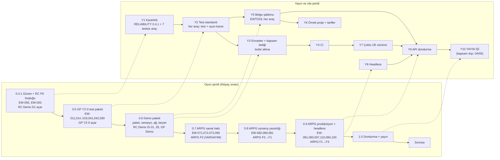

# 08 — Tam sistem yol haritası v2 (0.4.1 → 0.5 → … → 1.0 → sonrası)

Kart: `t_ae3a845a` · 18.11.2026 · Yalnız belge.
**Bu belge `03_Yol_Haritasi.md`'nin yerini alır** (03 silinmedi; eski satırların karşılığı §9).
Girdi: 06 (56 ihtiyaç, EW-xxx), 07 (Var 18 / Kısmen 20 / Yok 18). Sıra = oyunların ihtiyaç anı; **tarih hedefi yok**.

Okuma kuralları:
- **TAHMİN** = efor tahmini, saat (ajan + Talha onayı dahil). Kaynakta sayı varsa kaynak yazılı (03 = `03_Yol_Haritasi.md` satırı; AT = ARPG §12.3 "kart-gün").
- **Araç adı = çalışma adı.** Ad ve sözleşme 09 §1 kurallarına uyar; kesin ad araç yazılırken verilir.
- Her sürümün iki şeridi var: **Oyun şeridi** (oyun işini açan araçlar) ve **Cila şeridi** (kararlılık, belge, örnek, CI, çoklu UE, headless). Cila şeridinin bitiş ölçütleri §8'de tek tabloda.
- Sürüm sırası Talha kararına bağlı (SORULAR_2 S2-01). Aşağıdaki sıra öneridir.

---

## 1. Genel akış



ASCII özet (aynı sıra):

```
OYUN ŞERİDİ   0.4.1 ──► 0.5 ──► 0.6 ──► 0.7 ──► 0.8 ──► 0.9 ──► 1.0 ──► Sonrası
              RC D1     GP YZ-0  RC+GP    ARPG F0  ARPG F0  ARPG F1+  dondur
              (küçük)   (tüm 9)  Demo     sanat    YZ/GAS   headless  + yayın
                │         │        │                          │        │
CİLA ŞERİDİ    Y1 ──────►Y2 ─────►Y3 ──► Y4 ──► Y7 ─────────►Y9 ─────►Y10
              kararlılık test std  betik   CI     çoklu UE   dondurma  YAYIN İŞİ
                          └──────►Y5 ──► Y6                  ▲
                                  belge   örnek       Y8 headless (0.9)
```

### 1.1 Sıranın gerekçesi (kaynaklı)

| Sıra | Neden bu yerde | Kaynak |
|---|---|---|
| 0.4.1 önce | Küçük (≈ 30 sa TAHMİN). RC aktif üretimde; RC'nin tek "Yok" P0'ı EW-R11 (EW-055). Kararlılık düzeltmeleri bütün oyunları korur. | RC12 §11.1 ("tek P0 eksik araç"), RELIABILITY_0.4.md §Kept for 0.4.1 |
| 0.5 GP | GP kuralı: EW-GP-01…08 YZ-0'dan önce **zorunlu**; YZ-0 bunlar olmadan başlamaz. Geçici yolu yok. | GP16 §16 kural 1 (K-131), GP SORULAR S11 |
| 0.6 Demo | RC Demo D1 → IS-31…35 (paket, playtest, co-op, kapı, Next Fest build) ve GP Demo GI-07/GI-29 bunları ister. 0.4.1 + 0.5'teki ölçüm araçlarını kullanır. | RC13E §4, GP09 |
| 0.7–0.9 ARPG | T4 VARSAYIMI: ARPG tam prodüksiyonu RC demosundan sonra; F0 "Enginewright ARPG paketi paralel 2–3 ay". AT sırası: EW-1 → EW-2 → EW-5 → EW-3 → EW-4 → EW-7 → EW-8 → EW-10 → EW-6 → EW-9 → EW-11; ilk dördü prototipten önce. | AT:285, AT:292, AT §12.4 |
| 1.0 | Yeni oyun aracı yok; dondurma + cila + yayın işi kilometre taşı. | 03:64 (API freeze), görev kartı |

---

## 2. v0.4.1 — "Güven + RC P0 boşluğu"

**Açtığı oyun işi:** RC Demo D1: IS-10 (veri aktarımı), LOC-4 → LOC-5 (taşma), IS-34 kapı. Bütün oyunlar: import ve PIE kararlılığı.
**Bağımlılık:** yok (ilk sürüm).

### 2.1 Oyun şeridi

| Araç (çalışma adı) | İhtiyaç | Sözleşme (girdi → çıktı) | Kabul ölçütü (test / kanıt) | Efor TAHMİN |
|---|---|---|---|---|
| `text_overflow_audit` (yeni) | EW-055 | widget yolu ya da açık UI + kültür listesi → TextBlock başına istenen/ayrılan genişlik, taşma listesi | `tests/` içinde taşan + taşmayan widget (2 durum) · RC'de 1 ekran × 2 dil (EN, DE ya da RU) raporu, ekran görüntüsüyle karşılaştırma | 8 sa |
| `datatable_import` (yeni) | EW-002 | CSV/JSON yolu + tablo + `dryRun` → eklenen/değişen/silinen satır listesi; katı alan denetimi | `tests/`: upsert + fark + bilinmeyen alan reddi · RC `DT_Cards` 48+4+21 satır dryRun → uygula → `datatable_get` aynı | 6 sa (03:51 "datatable_csv" 8 sa, export hariç) |
| RC deneme koşusu (araç değil, iş) | EW-001, 005, 006, 050–053, 060, 061, 111 | Var araçları RC'de ilk kez gerçek veriyle çalıştır | Her ihtiyaç için 1 kayıt (çağrı, süre, sonuç) → `docs/oyun_kosulari/RC_0.4.1.md` (yeni dosya, ad önerisi) | 4 sa |

### 2.2 Cila şeridi (Y1 Kararlılık)

| İş | Kaynak | Kabul | Efor TAHMİN |
|---|---|---|---|
| `asset_find` olmayan klasör uyarısı | RELIABILITY_0.4.md:67, §Kept | `tests/` uyarı alanı var | 1 sa |
| ASCII dışı asset adı uyarısı (`asset_import`, `blueprint_create`) | RELIABILITY_0.4.md:68, :81 | `BP_Çaydanlık` → uyarı | 2 sa |
| `game_run` koşu saklama kuralı (son N) | §Kept (145 koşu / 243 MB) | N+1. koşuda en eski silinir; test | 2 sa |
| `actor_preview` kamera kollu Character çerçevesi | RELIABILITY_0.4.md:61 | Character + SpringArm testi, çerçeve gövdeye oturur | 3 sa |
| `pie_start` ilk açılış / listen TIMEOUT: süre parametresi + belgede uyarı | RELIABILITY_0.4.md:140, §Kept | RC ana menü 2 oyunculu açılış TIMEOUT yerine ayarlı bekleme | 2 sa |
| 7 testsiz araca test: `perf_capture`, `perf_scene`, `perf_gpu_profile`, `mrq_render`, `mrq_status`, `asset_references`, `asset_save` | arac_test_kapsami.json | 129/129 araç en az 1 test dosyasında | 6 sa |
| 5 aracı RELIABILITY tablosuna ekle (perf ×3, mrq ×2) | arac_test_kapsami.json | RELIABILITY satırı OK/NOTE | 1 sa |

**Toplam TAHMİN:** oyun 18 sa + cila 17 sa ≈ **35 sa**.
**Riskler:** (1) Taşma ölçümü Slate'in istenen boyutuna dayanır; `Auto Wrap` ve ölçek kutularında yanlış pozitif → 2 durumlu test zorunlu. (2) RC deneme koşusu "Var" sanılan araçta açık bulabilir → sürüm 0.4.2 olarak çıkar (kapsam büyütme yok).

---

## 3. v0.5 — "GP YZ-0 test paketi"

**Açtığı oyun işi:** GP YZ-0 (kapı G0…G3). Yan fayda: RC IS-31/IS-32 (paketli FPS, bot ölçümü), ARPG IC-12 (ölçüm okuma).
**Bağımlılık:** 0.4.1 (`game_run` saklama, perf testleri). GP tarafında: YZ-0 test modülü iskeleti (`AGPAITestScenario`, `metrics.json` biçimi) uçtan uca kabul için gerekli → tavuk-yumurta, bkz risk 1.

| Araç (çalışma adı; GP16 adı) | İhtiyaç | Sözleşme | Kabul ölçütü | GP kapısı | Efor TAHMİN |
|---|---|---|---|---|---|
| `automation_run` genişletme: `headless` + rapor ayrıştırma (`automation_run`) | EW-011 (EW-010 Var) | filtre + `headless:true` → `-game -nullrhi` süreç, rapor json → geçti/kaldı/süre listesi | Enginewright test projesinde 1 geçen + 1 kalan test · GP S1 Koridor 3 senaryo raporu | G0 | 5 sa |
| `metrics_read` (`ai_metrics_read`) | EW-014 | dosya/klasör (son koşu) + eşik listesi → özet + kapı sonucu (geçti/kaldı/eksik) | Örnek `metrics.json` + eşik dosyasıyla test · GP G0 özeti ajan bağlamına < 2 KB | G0 | 4 sa |
| `scenario_place` (`scenario_place`) — isteğe bağlı | EW-019 | harita + veri listesi (sınıf, konum, etiket, Smart Object) → yerleşen aktörler + kayıt | 10 aktörlük liste tek çağrı · GP S1/S2 | G0 (S11) | 5 sa |
| `vislog_extract` (`vislog_extract`) | EW-015 | `.bvlog` + aktör + zaman aralığı → olay satırları + isteğe bağlı PNG | Elle kaydedilmiş küçük `.bvlog` testi · GP G1 bir kırmızı olay | G1 | 8 sa |
| `nav_build_check` (`nav_build_check`) | EW-090 | harita + nokta listesi (siper) → build sonucu, kopuk ada sayısı, ulaşılamaz noktalar | Test haritası: 1 kopuk ada bulunur · GP M1 | G1 | 6 sa |
| `gdt_snapshot` (`gdt_snapshot`) | EW-016 | PIE + aktör + kategori → metin dökümü + ekran görüntüsü | Test projesinde varsayılan kategori · GP utility puanı | G1 | 5 sa |
| `perf_capture` + `scope` (`perf_capture` + `scope`) | EW-041 | stat grubu filtresi | `stat group` filtresiyle test · GP `GPAI_*` | G1 | 3 sa |
| `game_perf_sample` (E22) | EW-042 | `game_run` koşusu + örnek aralığı → kare süresi ortalama / p95 / takılma sayısı | Paketli test oyunu · RC IS-31 1080p / 800p pencere | G1 | 6 sa |
| `statetree_debug_dump` (`statetree_debug_dump`) | EW-017 | PIE + aktör + süre → aktif durum geçmişi metni | Test StateTree 3 durum geçişi · GP M12 | G2 | 8 sa |
| `soak_run` (`soak_run`) | EW-018 | paket yolu + süre + örnek aralığı → zaman serisi (bellek, ms, takılma) + çökme özeti | 5 dk test koşusu · GP 30 dk | G3 | 5 sa |

**Cila şeridi:** Y2 Test standardı başlar (09 §3). Her yeni araç: `tests/` dosyası + oyun kanıtı kaydı. RELIABILITY_0.5.md (yeni dosya) bu sürümün araçlarıyla açılır.
**Toplam TAHMİN:** ≈ **55 sa** (EW-019 hariç 50 sa). GP16 "ajan saati kart açılırken tahmin edilir" diyor (GP16 kural 1); bu sayı ilk tahmindir.
**Riskler:**
1. GP YZ-0 kodu yokken uçtan uca kabul olmaz. Çözüm: her araç önce Enginewright test projesinde kabul; GP kabulü YZ-0 ilk haftasında (GP kuralı "araç önce" ile çelişir → SORULAR_2 S2-02).
2. `vislog_extract`: `.bvlog` ikili biçimi motor sürümüne bağlı; okuma `FVisualLoggerHelpers` üzerinden olmalı (TAHMİN). Olmazsa canlı Visual Logger'dan dışa aktarma.
3. `statetree_debug_dump`: StateTree hata ayıklayıcısı yalnız editör yapısında (`WITH_STATETREE_DEBUGGER`, TAHMİN) → paket koşusunda çalışmaz; PIE ile sınırlı kabul.
4. GP araç adları (`ai_metrics_read`) GP'ye özgü; genel ad (`metrics_read`) önerildi → S2-06.

---

## 4. v0.6 — "Demo paketi: paket, senaryo, ağ, beyan"

**Açtığı oyun işi:** RC IS-31 (paket + perf), IS-32 (playtest/denge), IS-33 (co-op), IS-34 (demo kapısı), IS-35 (Next Fest build + beyan), LOC-4 tam döngü. GP Demo: GI-03 (yerleşim), GI-07 (ağ), GI-29 (sim köprüsü), içerik GI-xx (DataAsset). ARPG IC-01/IC-12 (veri + ölçüm) hazır olur.
**Bağımlılık:** 0.5 (`metrics_read`, `game_perf_sample`), 0.4.1 (`datatable_import`).

| Araç (çalışma adı) | İhtiyaç | Sözleşme | Kabul ölçütü | Açtığı iş | Efor TAHMİN |
|---|---|---|---|---|---|
| `package_build` + `package_status` | EW-043 (B17) | platform, yapılandırma, hedef (game/server), çıkış klasörü → zip/klasör yolu, log özeti, süre (async) | Test projesi Win64 Development paketi · RC demo paketi elle adım 0 | RC IS-31/35, GP Demo, ARPG Demo | 8 sa (03:31) |
| `pie_scenario` | EW-012 | adım listesi (`araç`, `girdi`, `bekle`, `iddia`) → adım başına sonuç + ilk hata | Test: 5 adım, 1 bilinçli hata yakalanır · RC EK-03 bir kural kartı | RC IS-21, IS-62 · ARPG senaryo | 6 sa (03:35) |
| `bot_run` (kalıp: `game_run` + `metrics_read`) | EW-013 | oyunun bot komutu + süre + metrik yolu → özet | RC `RC.BotRun` 1 koşu (RC 09:87) · ARPG IC-12 CSV | RC IS-32, IS-52 · ARPG IC-43 · GP bot profilleri | 3 sa |
| `replication_check` | EW-031 | aktör filtresi + özellik listesi → server/istemci fark listesi | 2 istemci test: bilinçli replike edilmeyen değer bulunur · GP GI-07 | GP GI-07 · RC IS-33 | 4 sa (03:57) |
| `loc_screen_sweep` | EW-054 | kültür listesi + ekran listesi → dil × ekran PNG + `text_overflow_audit` sonucu | RC 2 dil × 3 ekran tek çağrı | RC LOC-4, LOC-5 | 5 sa |
| `asset_metadata_set` / `asset_declaration_report` | EW-075 (E14) | asset + {kaynak, lisans, ai} → yaz + oku; klasör → beyan CSV | 10 asset yaz-oku · RC `Asset_Kaydi.csv` ile karşılaştırma | RC IS-35, IS-53 · ARPG 1.0 | 4 sa (03:62 2 sa + rapor) |
| `placeholder_report` (`asset_references` üstüne) | EW-074 | klasör + desen → asset başına oyuncu yolu referans sayısı | RC `_Kullanilmayan` klasörü: referans 0 kanıtı | RC IS-30 ★ · GP K-70 | 3 sa |
| `data_export` | EW-004 (E18) | DataTable/DataAsset → CSV/JSON (+ sim çıktısıyla fark) | `datatable_import` ile gidiş-dönüş 0 kayıp | GP GI-29 · ARPG IC-12/IC-43 · RC IS-32 | 4 sa |
| `dataasset_create` (toplu, şablondan) | EW-003 | sınıf + satır listesi → N DataAsset + rapor | 20 asset tek çağrı, `validate` temiz | GP içerik GI-02…27 · ARPG F1 | 4 sa |
| `screenshot_tour` | EW-064 | kamera noktası listesi → PNG + manifest | Test haritası 5 nokta · RC mağaza 8 kare | RC IS-35, IS-53 | 6 sa (03:32) |
| `image_stats` bölge maskesi + palet | EW-063 | görsel + bölge listesi → bölge başına L*, palet, gürültü | RC `stil_olcu.py` ile aynı sonuç (±%2) | RC IS-03 sonrası denetim | 3 sa |
| `scenario_place` → yerleşim seti modu | EW-092 | grup + tohum → yerleşen aktörler | GP GI-03 1 mekân | GP GI-03, GI-26 | 2 sa |

**Cila şeridi:** Y3 envanter + test kapsamı betikleri `research/` → `tools/` (09 §3.3). Y5 belge şablonu (09 §4) bütün yeni araçlara.
**Toplam TAHMİN:** ≈ **52 sa**.
**Riskler:** (1) `package_build` editör içinden RunUAT çağrısı uzun sürer, editörü kilitler mi? Ayrı süreç (async) zorunlu (TAHMİN). (2) Steam Deck ölçümü ve 2 makine testi araçla çözülmez (EW-032, EW-042 Deck kısmı) → elle iş olarak kalır. (3) Kapsam büyük; RC Demo zamanı yaklaşırsa 0.6a (paket, senaryo, bot, beyan) / 0.6b (gerisi) bölünür → S2-07.

---

## 5. v0.7 — "ARPG sanat hattı" (VARSAYIM: T1 = UE 5.8, T4 = ön-prodüksiyon şimdi)

**Açtığı oyun işi:** ARPG F0 stil testi ve "Enginewright ARPG paketi" (AT:292); AT sırası EW-1 → EW-2. Yan fayda: GP YZ-2 retarget + Physical Animation (GP06:22), RC Garmr (RC12 §11).
**Bağımlılık:** 0.4.1 (`asset_import` ASCII uyarısı, `actor_preview` çerçevesi). ARPG T1 kararı (Unity seçilirse 0.7–0.9 ARPG gerekçesini kaybeder; GP/RC payı 1.0 sonrasına kayar).

| Araç (çalışma adı) | İhtiyaç | Kabul ölçütü | Efor TAHMİN |
|---|---|---|---|
| `skeletal_import` (iskelet + anim + soket + Physics Asset) | EW-071 (E23, ARPG EW-1) | 1 aile: FBX → SkeletalMesh + PhysicsAsset + 5 AnimSequence + 3 soket; `validate` temiz | AT EW-1: 6–8 kart-gün; 03:17 temel kısmı 8 sa |
| `anim_retarget` (IK Retargeter) | EW-071 | Kaynak → hedef iskelet 5 animasyon; GP YZ-2 bir karakter | (EW-1 içinde) |
| `montage_create` / `blendspace_create` / anim notify | EW-071 | 1 montage + 1 blendspace + 2 notify, PIE'de oynar | (EW-1 içinde) |
| `material_instances_for_mesh` | EW-072 (E24, ARPG EW-2) | Mesh slot başına MI + doku bağlama; 3 varyant | AT EW-2: 2 kart-gün (03:19 2 sa) |
| `actor_preview` `material_overrides` + `anim`/`time` | EW-065 (E25/E34) | 66 varyant panosu (8×8) tek çağrı | 4 sa |
| `art_budget_audit` | EW-073 | klasör + eşik (üçgen, doku) → aşanlar listesi; RC 155 asset | 3 sa |

**Toplam TAHMİN:** AT kart-gün ≈ 8–10 kart-gün (+ 7 sa).
**Riskler:** (1) En riskli sürüm: Interchange / FBX iskelet içe aktarma motor sürümüne çok bağlı (UE 5.8 VARSAYIM). (2) Retarget varlıkları (IKRig) editör veri modeli değişken (TAHMİN) → Y7 çoklu UE sürümünde ilk kırılacak yer.

---

## 6. v0.8 — "ARPG oynanış yazarlığı" (GAS, StateTree/BT, AnimBP)

**Açtığı oyun işi:** ARPG F0 → F1 grind prototipi (AT sırası EW-5 → EW-3 prototipten önce; EW-4 sonra). ARPG IC-02 attribute set. GP: StateTree okuma (0.5 `statetree_debug_dump`) ile ortak altyapı.
**Bağımlılık:** 0.7 (iskelet + anim varlıkları; AnimBP şablonu bunlara bağlı).

| Araç (çalışma adı) | İhtiyaç | Kabul ölçütü | Efor TAHMİN |
|---|---|---|---|
| GAS: `ability_create`, `effect_create`, `attribute_set_info`, `cue_create`, `gas_test` | EW-082 (ARPG EW-5) | 1 Ability + 2 Effect + 1 Cue PIE'de uygulanır; `gas_test` attribute değişimini iddia eder | AT EW-5: 5–6 kart-gün |
| `statetree_create` / `statetree_node_add` / `behaviortree_create` | EW-080 (ARPG EW-3, B14) | 1 düşman ailesi şablonu JSON → StateTree; `validate` temiz; PIE'de 3 durum | AT EW-3: 4–5 kart-gün (03:36 12 sa) |
| `animbp_statemachine_template` | EW-081 (ARPG EW-4, B13) | 1 iskelet ailesi: Idle/Move/Attack/Death durumları, varyantta parametreyle | AT EW-4: 3–4 kart-gün (03:37 8 sa) |

**Toplam TAHMİN:** ≈ 12–15 kart-gün.
**Riskler:** (1) StateTree ve AnimGraph düzenleme API'leri editör modülü içinde, kararlı genel API yok (TAHMİN) → ince yüzey (şablon kopyala + parametre) kabul edilir; serbest grafik yazma yok. (2) GP StateTree'yi elle (C++) kuruyor; EW-080'e GP'yi eklemek TAHMİN (S2-05).

---

## 7. v0.9 — "ARPG prodüksiyon + headless + dondurma adayı"

**Açtığı oyun işi:** ARPG F1 IC-10 (oda/kat), Dikey dilim IC-16 (VFX), F3 prodüksiyon (headless), 1.0 IC-68 (içerik testi). GP fizik (YZ-1 ragdoll). RC EA IS-53 (Sequencer).
**Bağımlılık:** 0.8. Headless (EW-110) Y8 ile ortak.

| Araç (çalışma adı) | İhtiyaç | Kabul ölçütü | Efor TAHMİN |
|---|---|---|---|
| `room_validate` (port, ızgara, nav) | EW-091 (ARPG EW-7) | 1 kit × 5 oda; bilinçli bozuk port bulunur; `nav_build_check` ile | AT EW-7: 4–5 kart-gün |
| `niagara_info` / `niagara_variant` / önizleme | EW-083 (ARPG EW-6) | 1 sistem → 4 element varyantı + pano | AT EW-6: 4 kart-gün |
| `content_smoke` (satır başına spawn + log iddiası) | EW-007 | 50 satırlık tablo, 1 bilinçli bozuk satır bulunur | 6 sa |
| Headless mod (commandlet + MCP; önce import + veri araçları) | EW-110 (ARPG EW-9, B18) | Editör kapalı: 100 asset import + `datatable_import`, rapor editör içiyle aynı | AT EW-9: 6–8 kart-gün (03:61 12 sa yalnız import) |
| `physics_test` | EW-084 | Ragdoll + sekme senaryosu, 3 tekrarda sonuç sapması raporu | 4 sa (03:60) |
| `sequence_create` / kamera / kesme | EW-100 (ARPG EW-11, E29) | 1 ara sahne: 2 kamera, 1 kesme; `mrq_render` ile çıktı | AT EW-11: 3 kart-gün |

**Cila şeridi:** Y9 API dondurma adayı: araç adları ve şemaları listelenir (09 §1 kurallarına uymayanlar yeniden adlandırılır, eski ad takma ad olarak 1.0'a kadar kalır).
**Toplam TAHMİN:** ≈ 18–21 kart-gün + 10 sa.
**Riskler:** Headless'ta editör altsistemleri (AssetTools, Slate) yok → her araç "headless uyumlu" bayrağı taşır (09 §1). Niagara düzenleme API'si de editöre bağlı (TAHMİN).

---

## 8. v1.0 — "Dondurma + cila + yayın işi"

**Oyun şeridi:** yeni oyun aracı yok. Üç oyunda son kanıt koşusu (her "Var" ihtiyaç için 1 kayıt; 07 durumları güncellenir).
**Cila şeridi (bitiş ölçütleri):**

| Kilometre taşı | Kabul ölçütü |
|---|---|
| Y1 Kararlılık | RELIABILITY_1.0.md: bütün araçlar OK/FIXED; NOTE yalnız belgelenmiş motor sınırı |
| Y2 Test | 129 + yeni araçların hepsi `tests/` içinde; `run_all.py` tek komut |
| Y4 CI | 09 §3.4 seçeneğine göre (S2-08) derleme + test koşusu her sürümde |
| Y5 Belge | Her araç EWTOOL şablonunda (09 §4) |
| Y6 Örnek | Örnek proje + 3 oyun iş akışı tarifi (veri, test, sanat) |
| Y7 Çoklu UE | S2-09 kararındaki sürümlerde derleme + `run_all.py` |
| Y9 API dondurma | 0.9 adayı onaylı; 1.x içinde araç adı/şema kırılmaz |
| **Y10 YAYIN İŞİ** | **Kapsam dışı (04, 05, SORULAR S-0…S-10).** Bu kart karar vermez; yalnız yer tutar. |

**Toplam TAHMİN:** ≈ 40 sa (03:68 "~40 saat" duyuru hariç; aynı sayı).

## 9. Sonrası (1.0+)

| İş | İhtiyaç | Neden sonra |
|---|---|---|
| Take Recorder → sekans → MRQ | EW-102 (E32) | RC EA IS-53 P2; tek kullanıcı RC (RC12 §11.1 P2) |
| 2 makine / Steam co-op otomasyonu | EW-032 | Araçla çözülmez (TAHMİN); elle |
| Steam Deck cihaz ölçümü | EW-042 (Deck kısmı) | Cihaz başında elle |
| Mutable | — (03:38) | Hiçbir oyun belgesinde ihtiyaç yok (06'da satır yok) |
| `scene_snapshot` / `scene_diff`, `world_inventory`, `log_analyze`, `level_flow_test`, `travel_test_suite` | — (03:39, 03:53–59) | 03'te vardı; 3 oyunun güncel listelerinde karşılığı yok → S2-10 |

## 10. Sürüm × ihtiyaç kapsamı (doğrulama)

Her "Kısmen" ve "Yok" ihtiyaç bir sürüme bağlı mı? `research/yol_kapsam.py` bu belgeyi okur ve 06/07 verisiyle karşılaştırır (çıktı aşağıda).

YOL_KAPSAM_TABLOSU

## 11. Eski yol haritasıyla eşleme (03_Yol_Haritasi.md, satır silinmedi)

| 03'teki araç (satır) | Durum | Bu belgede |
|---|---|---|
| `asset_pipeline` (03:15), `asset_import_batch` (03:16) | **değişti** | `asset_import` + `batch` zaten Var (EW-070); eksik kısım klasör tarama → 0.7 `art_budget_audit` ile, ayrı araç yok |
| `skeletal_import` (03:17) | **taşındı** | 0.4.1 → 0.7 (ARPG ihtiyaç anı; RC yalnız Garmr, EA) |
| `image_diff` (03:18) | **iptal** | `screenshot_ab` + `image_stats` Var (EW-062) |
| `material_variants` (03:19) | **devam** | 0.7 `material_instances_for_mesh` + `actor_preview` genişletme |
| `package_build` (03:31) | **taşındı** | 0.5 → 0.6 |
| `screenshot_tour` (03:32), `visual_review` (03:33) | **devam / birleşti** | 0.6 `screenshot_tour`; `visual_review` = `image_compose` (Var) |
| `coop_test` (03:34) | **değişti** | `pie_start` + `pie_net_emulation` Var (EW-030); 0.6 `replication_check` |
| `pie_scenario` (03:35) | **devam** | 0.6 |
| `statetree_*`, `behaviortree_*` (03:36), `animbp_statemachine_template` (03:37) | **taşındı** | 0.5 → 0.8 |
| `mutable_tools` (03:38), `travel_test_suite` (03:39) | **sonraya** | §9 |
| `datatable_csv` (03:51) | **bölündü** | 0.4.1 `datatable_import` + 0.6 `data_export` |
| `blueprint_compile_all` (03:52) | **iptal** | `validate` Var (EW-006) |
| `world_inventory`, `actor_set_props`, `scene_snapshot/diff`, `log_analyze`, `level_flow_test` (03:53–59) | **sonraya** | §9, S2-10 |
| `net_test_2pc` (03:56) | **değişti** | EW-030 Var + EW-032 elle |
| `replication_check` (03:57) | **devam** | 0.6 |
| `physics_test` (03:60) | **taşındı** | 0.6 → 0.9 |
| `headless_import` (03:61) | **taşındı** | 0.6 → 0.9 (Y8) |
| `asset_metadata_set` (03:62) | **devam** | 0.6 + rapor |
| 1.0 SEO / registry / Pages / awesome / video (03:74–80) | **kapsam dışı** | Y10 YAYIN İŞİ (bu kart karar vermez) |
